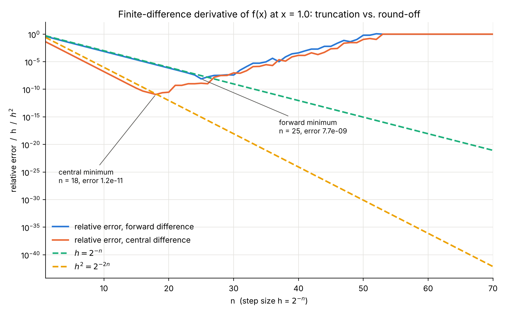

Slide references ("slide N") point to the lecture *Part 2: Representation of numbers in digital computers*.

**Notation.** A hat marks the floating-point version of a number, $\hat x = rd(x) = x(1+\delta_x)$. The operators $\oplus,\ominus,\otimes,\oslash$ are the floating-point operations. Machine epsilon is $\epsilon = 2^{-(p-1)}$, and the unit roundoff for round-to-nearest is $u = \epsilon/2$ (slides 31, 33).

# Exercise 1: Floating point numbers (6P)

## 1(a) Relative error of $y/(x*z)$

**Idea.** Apply the same recipe the lecture uses for multiplication (slide 39): write every rounding as a factor $(1+\delta)$, multiply everything out, and drop terms of order $\epsilon^2$.

**Step 1: exact result.** Let
$$
u_{ex} = \frac{y}{x\,z}.
$$

**Step 2: rounding of the inputs.** The stored inputs are
$$
\hat x = x(1+\delta_x),\qquad \hat y = y(1+\delta_y),\qquad \hat z = z(1+\delta_z).
$$

**Step 3: the multiplication in the denominator.** Using the model $\hat a \otimes \hat b = (1+\delta_\otimes)\,\hat a\,\hat b$ from slide 34:
$$
\hat v = \hat x \otimes \hat z = (1+\delta_\otimes)(1+\delta_x)(1+\delta_z)\,x\,z .
$$

**Step 4: the division.** Using $\hat a \oslash \hat b = (1+\delta_\oslash)\,\hat a/\hat b$:
$$
\hat u = \hat y \oslash \hat v
= \frac{(1+\delta_\oslash)(1+\delta_y)}{(1+\delta_\otimes)(1+\delta_x)(1+\delta_z)}\;\frac{y}{x\,z}.
$$

**Step 5: linearise.** For small $\delta$ we have $\dfrac{1}{1+\delta} = 1-\delta+\mathcal O(\delta^2)$, and products of two deltas are $\mathcal O(\epsilon^2)\ll\mathcal O(\epsilon)$. Therefore
$$
\frac{\hat u}{u_{ex}} = 1+\delta_\oslash+\delta_y-\delta_\otimes-\delta_x-\delta_z+\mathcal O(\epsilon^2).
$$

**Step 6: total relative error.**
$$
\boxed{\;\delta=\frac{\hat u-u_{ex}}{u_{ex}}\approx \delta_\oslash+\delta_y-\delta_\otimes-\delta_x-\delta_z\;}
$$

**Step 7: bound.** With the triangle inequality and $|\delta_\bullet|\le\epsilon$ (slides 33, 34):
$$
|\delta|\le|\delta_\oslash|+|\delta_y|+|\delta_\otimes|+|\delta_x|+|\delta_z|\le 5\,\epsilon .
$$
For round-to-nearest each $|\delta_\bullet|\le\epsilon/2$, so the sharper bound is $|\delta|\le 2.5\,\epsilon$.

**Comparison with $\epsilon$ and conclusion.**

- The relative error is at most a small multiple of $\epsilon$: five rounding events give at most $5\epsilon$. In double precision this is about $5\cdot 2.2\times10^{-16}\approx 1.1\times10^{-15}$.
- The bound does **not** depend on the values of $x,y,z$. There is no amplification factor such as the $|y/(x+y)|$ that appears for addition (slide 36).
- So multiplication and division are **well-conditioned**: errors only add up linearly, one $\epsilon$ per rounding. This holds as long as no overflow or underflow occurs and $x,y,z\neq0$. Only addition or subtraction of nearly equal numbers can produce catastrophic cancellation.
- If $x,y,z$ are already exact machine numbers, then $\delta_x=\delta_y=\delta_z=0$, and only the two operations contribute: $|\delta|\le2\epsilon$ (or $\le\epsilon$ for round-to-nearest).

**Numerical check.** In 200 000 random double-precision trials evaluated with exact rational arithmetic, the largest observed error was about $2.1\,\epsilon$ with rounded inputs and about $0.97\,\epsilon$ with exact inputs. Both are inside the round-to-nearest bounds of $2.5\,\epsilon$ and $\epsilon$.

## 1(b) Non-associativity of addition

Use decimal floating-point numbers with **two significant digits** and round-to-nearest (slides 37, 42). Choose
$$
x = 8.6,\qquad y = 0.038,\qquad z = 0.026 .
$$

The exact sum is $x+y+z = 8.664$, and correctly rounded to two digits this is $8.7$.

**Order A: $(x\oplus y)\oplus z$**
$$
x\oplus y = rd(8.638)=8.6,\qquad 8.6\oplus z = rd(8.626)=8.6 .
$$

**Order B: $x\oplus(y\oplus z)$**
$$
y\oplus z = rd(0.064)=0.064,\qquad x\oplus 0.064 = rd(8.664)=8.7 .
$$

| Order | Result | Absolute error | Relative error |
|:--|:-:|:-:|:-:|
| $(x\oplus y)\oplus z$ | $8.6$ | $0.064$ | $7.4\times10^{-3}$ |
| $x\oplus(y\oplus z)$ | $8.7$ | $0.036$ | $4.2\times10^{-3}$ |

Hence $(x\oplus y)\oplus z \ne x\oplus(y\oplus z)$.

**Why it happens.** The last kept digit of $8.6$ has weight $0.1$, so anything smaller than half of that, $0.05$, is lost when added on its own. Both $y$ and $z$ are below $0.05$, so in order A each of them disappears. In order B they are first combined into $0.064>0.05$, which is large enough to change the result. This confirms the rule from slide 42: **add the small numbers first.**

*Choosing your own values:* the sheet requires individual values. Any $x$ with two significant digits such as $d.d$ works, together with $y,z$ having $0<y,z<0.05$ and $y+z>0.05$, as long as no intermediate result lands exactly on a rounding tie.

## 1(c) Machine epsilon in Python

**Program** (`ps_4_ex_1c_MATRNR.py`):

```python
"""Problem sheet 4, exercise 1(c).

Find the largest x = 2**(-n) for which 1.0 + x == 1.0 in double precision,
compare it with NumPy's machine epsilon and derive the number of mantissa bits.
"""
import numpy as np
import matplotlib.pyplot as plt  # required header of the sheet (not used in 1c)

# Halve x until adding it to 1.0 no longer changes 1.0.  The powers of two are
# scanned from large to small, so the first hit is the largest such x.
n = 0
x = 1.0
while 1.0 + x != 1.0:
    n += 1
    x = 2.0 ** (-n)

eps = np.finfo(float).eps
mantissa_bits_stored = -int(np.log2(eps))  # eps = 2**(-(p-1)) = 2**(-N_m)
precision = mantissa_bits_stored + 1       # + implicit leading bit

print(f"largest x = 2^-n with 1.0 + x == 1.0: n = {n}, x = {x:.6e}")
print(f"1.0 + 2^-{n}     == 1.0 : {1.0 + 2.0 ** (-n) == 1.0}")
print(f"1.0 + 2^-{n - 1} == 1.0 : {1.0 + 2.0 ** (-(n - 1)) == 1.0}")
print(f"numpy.finfo(float).eps  = {eps:.6e}")
print(f"eps / x                 = {eps / x:.1f}")
print(f"stored mantissa bits  N_m = {mantissa_bits_stored} "
      f"(numpy.finfo(float).nmant = {np.finfo(float).nmant})")
print(f"precision p = N_m + 1     = {precision} (including the implicit bit)")
```

**Output:**

```text
largest x = 2^-n with 1.0 + x == 1.0: n = 53, x = 1.110223e-16
1.0 + 2^-53     == 1.0 : True
1.0 + 2^-52 == 1.0 : False
numpy.finfo(float).eps  = 2.220446e-16
eps / x                 = 2.0
stored mantissa bits  N_m = 52 (numpy.finfo(float).nmant = 52)
precision p = N_m + 1     = 53 (including the implicit bit)
```

**Result.** The largest value is $x = 2^{-53}\approx 1.11\times10^{-16}$.

**Comparison with `eps`.** NumPy gives `eps` $=2^{-52}\approx 2.22\times10^{-16}$, so
$$
x = \frac{\epsilon}{2} = u .
$$
The value found is exactly half of machine epsilon, which is the unit roundoff from slide 31.

**Why half of `eps`.** The next double after $1.0$ is $1+2^{-52}$. The number $1+2^{-53}$ lies exactly midway between $1$ and $1+2^{-52}$. IEEE 754 breaks such ties by rounding to the value with an even last mantissa bit, which is $1.0$. Every number slightly larger than $2^{-53}$ rounds up instead, so $2^{-53}$ is the largest value of any kind that leaves $1.0$ unchanged.

**Mantissa bits.** From slide 31, $\epsilon = 2^{-(p-1)}$:
$$
2^{-52}=2^{-(p-1)}\;\Rightarrow\; p-1=52\;\Rightarrow\; p=53 .
$$
Double precision therefore **stores $N_m=52$ mantissa bits**. Together with the implicit leading bit $a_0=1$ (slide 27), this gives a precision of $p=53$ bits, matching `numpy.finfo(float).nmant = 52` and slide 28.

# Exercise 2: Taylor series (4P)

A Taylor series about $x=a$ is
$$
f(x)=\sum_{k=0}^{\infty}\frac{f^{(k)}(a)}{k!}(x-a)^k .
$$

## 2(a) $f(x)=\dfrac{4}{(2+5x)^3}$ at $x=0$

**Step 1: derivatives.** Write $f(x)=4(2+5x)^{-3}$. Each differentiation brings down the next negative exponent and a factor of $5$ from the chain rule:
$$
\begin{aligned}
f'(x)&=4(-3)(5)(2+5x)^{-4},\\
f''(x)&=4(-3)(-4)(5^2)(2+5x)^{-5},\\
f^{(k)}(x)&=4\,(-1)^k\,\frac{(k+2)!}{2!}\,5^k\,(2+5x)^{-(k+3)} .
\end{aligned}
$$

**Step 2: evaluate at $x=0$.**
$$
f^{(k)}(0)=2\,(-1)^k\,(k+2)!\;\frac{5^k}{2^{k+3}} .
$$

**Step 3: Taylor coefficients.** Divide by $k!$ and use $(k+2)!/k!=(k+1)(k+2)$:
$$
c_k=\frac{f^{(k)}(0)}{k!}=(-1)^k\,(k+1)(k+2)\,\frac{5^k}{2^{k+2}} .
$$

**Result.**
$$
\boxed{\;\frac{4}{(2+5x)^3}=\sum_{k=0}^{\infty}(-1)^k\,(k+1)(k+2)\,\frac{5^k}{2^{k+2}}\,x^k
=\frac12-\frac{15}{4}x+\frac{75}{4}x^2-\frac{625}{8}x^3+\cdots\;}
$$

**Radius of convergence.** The singularity is at $x=-2/5$, so the series converges for $|x|<2/5$.

**Cross-check with the binomial series.** $f(x)=\tfrac12\,(1+\tfrac52x)^{-3}$ and $(1+w)^{-3}=\sum_k(-1)^k\tfrac{(k+1)(k+2)}{2}w^k$ give the same coefficients.

## 2(b) $f(x)=\sqrt[2/3]{1+3x}$ at $x=7$

**Step 1: rewrite the root.** A root with index $2/3$ is a power with exponent $1/(2/3)=3/2$:
$$
f(x)=(1+3x)^{3/2},\qquad 1+3\cdot7=22 .
$$

**Step 2: derivatives and values at $x=7$.**

| $k$ | $f^{(k)}(x)$ | $f^{(k)}(7)$ | $c_k=f^{(k)}(7)/k!$ | numeric |
|:-:|:-:|:-:|:-:|:-:|
| 0 | $(1+3x)^{3/2}$ | $22\sqrt{22}$ | $22\sqrt{22}$ | $103.1891$ |
| 1 | $\tfrac92(1+3x)^{1/2}$ | $\tfrac92\sqrt{22}$ | $\tfrac92\sqrt{22}$ | $21.1069$ |
| 2 | $\tfrac{27}{4}(1+3x)^{-1/2}$ | $\dfrac{27}{4\sqrt{22}}$ | $\dfrac{27}{8\sqrt{22}}$ | $0.71955$ |
| 3 | $-\tfrac{81}{8}(1+3x)^{-3/2}$ | $-\dfrac{81}{8\cdot22\sqrt{22}}$ | $-\dfrac{27}{16\cdot22\sqrt{22}}$ | $-0.016353$ |

Each derivative multiplies by the current exponent and by $3$, for example $\tfrac32\cdot3=\tfrac92$ and $\tfrac92\cdot\tfrac12\cdot3=\tfrac{27}{4}$. In the last row, $\tfrac{81}{8}/3!=\tfrac{27}{16}$.

**Result: the first four terms.**
$$
\boxed{\;f(x)\approx 22\sqrt{22}+\frac{9\sqrt{22}}{2}(x-7)+\frac{27}{8\sqrt{22}}(x-7)^2-\frac{27}{352\sqrt{22}}(x-7)^3\;}
$$
Numerically,
$$
f(x)\approx 103.1891+21.1069\,(x-7)+0.71955\,(x-7)^2-0.016353\,(x-7)^3 .
$$

**Check.** At $x=7.1$ the polynomial gives $105.30701298$ and the exact value is $105.30701306$. They agree to about 9 digits.

# Exercise 3: Taylor series, derivatives, and errors (10P)

## 3(a) Proof of the finite-difference formulas

**Forward difference (1).** The first-order Taylor expansion of $f(x+h)$ around $x$, with its remainder, is
$$
f(x+h)=f(x)+h\,f'(x)+\frac{h^2}{2}f''(x)+\mathcal O(h^3).
$$
Move $f(x)$ to the left and divide by $h$:
$$
\frac{f(x+h)-f(x)}{h}=f'(x)+\frac{h}{2}f''(x)+\mathcal O(h^2).
$$
Dropping the terms that vanish as $h\to0$ gives formula (1):
$$
f'(x)\approx\frac{f(x+h)-f(x)}{h}.\qquad\blacksquare
$$

**Central difference (2).** Expand both neighbours around $x$:
$$
\begin{aligned}
f(x+h)&=f(x)+h\,f'(x)+\frac{h^2}{2}f''(x)+\frac{h^3}{6}f'''(x)+\frac{h^4}{24}f^{(4)}(x)+\mathcal O(h^5),\\
f(x-h)&=f(x)-h\,f'(x)+\frac{h^2}{2}f''(x)-\frac{h^3}{6}f'''(x)+\frac{h^4}{24}f^{(4)}(x)+\mathcal O(h^5).
\end{aligned}
$$
Subtract the second from the first. All even-power terms cancel, including $f(x)$ and $f''(x)$:
$$
f(x+h)-f(x-h)=2h\,f'(x)+\frac{h^3}{3}f'''(x)+\mathcal O(h^5).
$$
Divide by $2h$:
$$
\frac{f(x+h)-f(x-h)}{2h}=f'(x)+\frac{h^2}{6}f'''(x)+\mathcal O(h^4),
$$
which gives formula (2):
$$
f'(x)\approx\frac{f(x+h)-f(x-h)}{2h}.\qquad\blacksquare
$$

Since $f$ in part (c) is complex-valued, the expansions apply to the real and imaginary parts separately, which is why they are written with $\mathcal O(\cdot)$ terms rather than a single intermediate point $\xi$.

## 3(b) Order of the truncation error

From the formulas above:

| Scheme | Truncation error | Order |
|:--|:-:|:-:|
| Forward (1) | $\tfrac{h}{2}f''(x)+\mathcal O(h^2)$ | $\mathcal O(h)$, first order |
| Central (2) | $\tfrac{h^2}{6}f'''(x)+\mathcal O(h^4)$ | $\mathcal O(h^2)$, second order |

The Taylor remainders are $\mathcal O(h^2)$ and $\mathcal O(h^3)$, and dividing by $h$ or $2h$ removes one power of $h$. Halving $h$ (that is, $n\to n+1$) therefore halves the forward error and divides the central error by four.

## 3(c) Program and plot

**Exact derivative.** For
$$
f(x)=\frac{2e^{ix}-3e^{-ix}}{-3i}
$$
differentiating term by term gives
$$
f'(x)=\frac{2i\,e^{ix}+3i\,e^{-ix}}{-3i}=-\frac{2e^{ix}+3e^{-ix}}{3},
$$
and at $x=1$:
$$
f'(1)\approx-0.900503843+0.280490328\,i,\qquad |f'(1)|\approx0.94318 .
$$

The relative error of an approximation $D_h$ is $|D_h-f'(1)|/|f'(1)|$.

**Program** (`ps_4_ex_3c_MATRNR.py`):

```python
"""Problem sheet 4, exercise 3(c).

Forward and central finite differences of
    f(x) = (2 exp(ix) - 3 exp(-ix)) / (-3i)
at x = 1.0 for h = 2**(-n), n = 1...70, with relative errors, h and h**2
on one logarithmic plot.
"""
from pathlib import Path

import numpy as np
import matplotlib.pyplot as plt


def f(x):
    return (2 * np.exp(1j * x) - 3 * np.exp(-1j * x)) / (-3j)


def df_exact(x):
    # d/dx: (2i exp(ix) + 3i exp(-ix)) / (-3i) = -(2 exp(ix) + 3 exp(-ix)) / 3
    return -(2 * np.exp(1j * x) + 3 * np.exp(-1j * x)) / 3


x0 = 1.0
n = np.arange(1, 71)
h = 2.0 ** (-n)

forward = (f(x0 + h) - f(x0)) / h
central = (f(x0 + h) - f(x0 - h)) / (2 * h)

exact = df_exact(x0)
err_forward = np.abs(forward - exact) / np.abs(exact)
err_central = np.abs(central - exact) / np.abs(exact)

best_f = np.argmin(err_forward)
best_c = np.argmin(err_central)

print(f"exact f'(1.0) = {exact:.15f}")
print(f"forward: minimum relative error {err_forward[best_f]:.3e} at n = {n[best_f]}")
print(f"central: minimum relative error {err_central[best_c]:.3e} at n = {n[best_c]}")
print(f"\n{'n':>3} {'h':>11} {'forward':>11} {'central':>11}")
for k in (1, 2, 4, 8, 12, 16, 18, 20, 24, 26, 28, 30, 36, 40, 44, 48, 50,
          51, 52, 53, 54, 55, 60, 70):
    i = k - 1
    print(f"{k:>3} {h[i]:>11.3e} {err_forward[i]:>11.3e} {err_central[i]:>11.3e}")

fig, ax = plt.subplots(figsize=(9, 5.6), dpi=200)
ax.semilogy(n, err_forward, color="#2a78d6", lw=2, label="relative error, forward difference")
ax.semilogy(n, err_central, color="#eb6834", lw=2, label="relative error, central difference")
ax.semilogy(n, h, color="#1baf7a", lw=2, ls="--", label=r"$h = 2^{-n}$")
ax.semilogy(n, h ** 2, color="#eda100", lw=2, ls="--", label=r"$h^2 = 2^{-2n}$")

ax.annotate(f"forward minimum\nn = {n[best_f]}, error {err_forward[best_f]:.1e}",
            xy=(n[best_f], err_forward[best_f]), xytext=(n[best_f] + 12, 1e-18),
            fontsize=9, color="#0b0b0b",
            arrowprops=dict(arrowstyle="-", color="#52514e", lw=0.8))
ax.annotate(f"central minimum\nn = {n[best_c]}, error {err_central[best_c]:.1e}",
            xy=(n[best_c], err_central[best_c]), xytext=(n[best_c] - 15, 1e-27),
            fontsize=9, color="#0b0b0b",
            arrowprops=dict(arrowstyle="-", color="#52514e", lw=0.8))

ax.set_xlabel("n  (step size h = $2^{-n}$)")
ax.set_ylabel("relative error  /  h  /  $h^2$")
ax.set_title("Finite-difference derivative of f(x) at x = 1.0: truncation vs. round-off")
ax.set_xlim(1, 70)
ax.grid(True, which="major", color="#e4e3df", lw=0.7)
for side in ("top", "right"):
    ax.spines[side].set_visible(False)
ax.legend(frameon=False, loc="lower left")
fig.tight_layout()
fig.savefig(Path(__file__).with_name("ps_4_ex_3c_plot.png"))
plt.show()
```

{width=100%}

**Selected values:**

| $n$ | $h$ | forward rel. error | central rel. error |
|:-:|:-:|:-:|:-:|
| 1 | $5.00\times10^{-1}$ | $4.05\times10^{-1}$ | $4.12\times10^{-2}$ |
| 8 | $3.91\times10^{-3}$ | $2.93\times10^{-3}$ | $2.54\times10^{-6}$ |
| 12 | $2.44\times10^{-4}$ | $1.83\times10^{-4}$ | $9.94\times10^{-9}$ |
| 16 | $1.53\times10^{-5}$ | $1.14\times10^{-5}$ | $4.78\times10^{-11}$ |
| 18 | $3.81\times10^{-6}$ | $2.86\times10^{-6}$ | $\mathbf{1.15\times10^{-11}}$ (min) |
| 25 | $2.98\times10^{-8}$ | $\mathbf{7.67\times10^{-9}}$ (min) | $1.25\times10^{-9}$ |
| 30 | $9.31\times10^{-10}$ | $3.84\times10^{-8}$ | $9.39\times10^{-8}$ |
| 40 | $9.09\times10^{-13}$ | $3.99\times10^{-4}$ | $1.42\times10^{-4}$ |
| 48 | $3.55\times10^{-15}$ | $4.23\times10^{-2}$ | $2.94\times10^{-2}$ |
| 52 | $2.22\times10^{-16}$ | $1.17$ | $1.11\times10^{-1}$ |
| 53 to 70 | $\le1.11\times10^{-16}$ | $1$ | $1$ |

## 3(d) Discussion and conclusions

The total error is the sum of two competing parts, the two error types from slide 30.

- **Truncation error** falls as $h$ shrinks: $\approx C_1h$ (forward) or $\approx C_2h^2$ (central).
- **Round-off error** grows as $h$ shrinks. The function values carry a relative error of about $\epsilon$, and the numerator $f(x+h)-f(x)$ subtracts two nearly equal numbers, which is the subtractive cancellation of slide 36. Dividing by the tiny $h$ then gives a relative error of about $\epsilon/h$.

**Small $n$ ($n<16$): truncation error dominates.**

- On the log-scale the curves are straight lines, confirming the orders from 3(b). The forward curve runs parallel to $h$, and the central curve runs parallel to $h^2$.
- The prefactors agree with theory. For the forward scheme the predicted relative error is $\frac{|f''(1)|}{2|f'(1)|}h\approx0.75\,h$; at $n=8$ this gives $2.93\times10^{-3}$, as measured. Here $f'''=-f'$, so the central scheme gives $h^2/6$; at $n=12$ this gives $9.93\times10^{-9}$, as measured.
- The central scheme is far more accurate at the same step size, by about four orders of magnitude at $n=12$. Round-off is still negligible here.
- Around $n=16$ the central curve starts to deviate above $h^2/6$ ($4.78\times10^{-11}$ against $3.88\times10^{-11}$). Round-off is becoming visible.

**The optimum.** Balancing truncation and round-off gives the best step size:

| Scheme | Balance | $h_{opt}$ | Expected min. error | Observed |
|:--|:-:|:-:|:-:|:-:|
| Forward | $h\sim\epsilon/h$ | $\sqrt\epsilon\approx2^{-26}$ | $\sim10^{-8}$ | $n=25$, $7.7\times10^{-9}$ |
| Central | $h^2\sim\epsilon/h$ | $\epsilon^{1/3}\approx2^{-17}$ | $\sim10^{-11}$ | $n=18$, $1.2\times10^{-11}$ |

**Large $n$ ($n>30$): round-off error dominates.**

- Decreasing $h$ further makes the result **worse**. The error grows roughly like $\epsilon/h$, i.e. it about doubles per step in $n$; at $n=40$, $\epsilon/h\approx2.4\times10^{-4}$, compared with the measured $4.0\times10^{-4}$ and $1.4\times10^{-4}$.
- The curves become jagged because the numerator can only take multiples of the small spacing of the stored floating-point values. The result is essentially rounding noise.
- The order advantage of the central scheme disappears. Both schemes have errors of the same size, since truncation plays no role there.

**Very large $n$: complete loss of information.**

- For $n\ge53$ we have `1.0 + h == 1.0`, exactly the result from 1(c), so $f(x+h)=f(x)$. The forward numerator is exactly $0$, the approximation is $0$, and the relative error is exactly $1$.
- For the central scheme, $n=53$ still has $1-2^{-53}\ne1$ because the spacing below $1$ is half as large, but $f(1-2^{-53})$ rounds to the same stored value as $f(1)$, so the numerator is $0$ here too. For $n\ge54$ both $x\pm h$ collapse to $x$. The error is $1$ for all $n\ge53$.
- Around $n\approx50$ to $52$ the approximation is useless (errors of order $0.1$ to $1$).

**Conclusions.**

1. Smaller $h$ does not always mean a better derivative. There is an optimal step size, here $h\approx2^{-25}$ (forward) and $h\approx2^{-18}$ (central).
2. The central scheme is the better choice. It reaches a minimum error almost three orders of magnitude lower and does so at a larger step size, with the same number of function evaluations (two) as the forward scheme.
3. The finite precision of the computer sets a hard limit. Neither scheme can reach machine precision: the best attainable errors are about $\sqrt\epsilon$ and $\epsilon^{2/3}$.
4. Using $h=2^{-n}$ is deliberate: these values and $1.0\pm h$ (for $n\le52$) are exactly representable, so no extra representation error enters through the step size itself.
