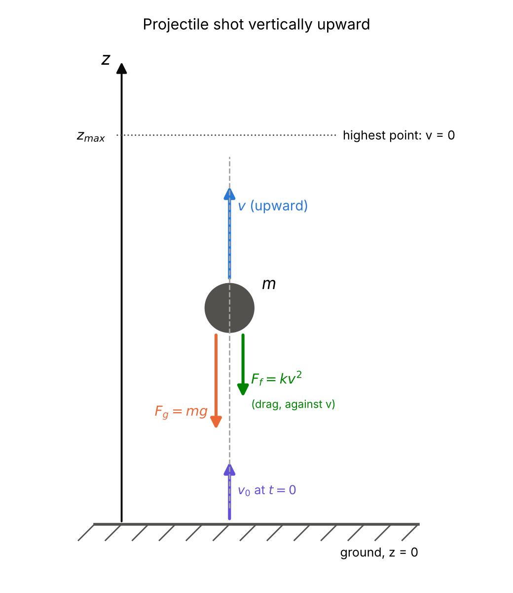
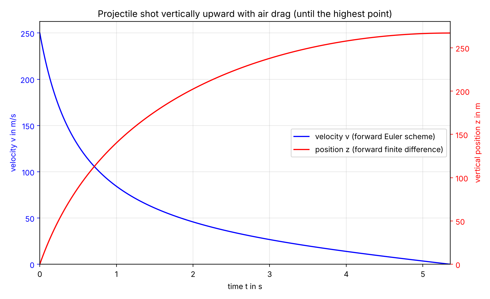

Slide references ("slide N") point to the lecture *Part 3: Continuous models: Ordinary differential equations*. The concept sheet `ps_5_concepts.md` explains every method used here with extra examples.

# Exercise 1: Classification of ODEs (2.5P + 0.5P)

**Rules used** (slides 17, 18, 23, 24):

- **Order:** highest derivative.
- **Scalar/vectorial:** is the unknown one function or a vector?
- **Linear:** can it be written as $\sum_j a_j(\cdot)\,\frac{d^j}{d\cdot^j}(\text{unknown}) + r = 0$? The coefficients may depend on the independent variable, but the unknown and its derivatives must appear only to the first power, not multiplied together and not inside functions.
- **Autonomous:** the independent variable does not appear explicitly.
- **Homogeneous:** bring everything to one side as on slide 24. The source term $r$ is the part that contains no unknown; $r=0$ means homogeneous. For the non-linear equations the same test is used ("is there a term without the unknown?"), since slide 24 defines the term only for linear ODEs.

## Summary table

| Eq. | Unknown (indep. var.) | (a) Order | (b) Scalar/vector | (c) Linear | (d) Autonomous | (e) Homogeneous, source term $r$ |
|:-:|:-:|:-:|:-:|:-:|:-:|:--|
| (1) | $x(y)$ | 4 | scalar | non-linear | autonomous | homogeneous, $r = 0$ |
| (2) | $\vec x(t)$ | 3 | vectorial | linear | non-autonomous | homogeneous, $r = 0$ |
| (3) | $u(t)$ | 1 | scalar | linear | non-autonomous | homogeneous, $r = 0$ |
| (4) | $y(x)$ | 2 | scalar | non-linear | non-autonomous | homogeneous, $r = 0$ |
| (5) | $y(t)$ | 1 | scalar | linear | non-autonomous | homogeneous, $r = 0$ |
| (6) | $x(t)$ | 1 | scalar | linear | non-autonomous | homogeneous, $r = 0$ |
| (7) | $y(t)$ | 3 | scalar | non-linear | non-autonomous | inhomogeneous, $r(t) = -\sin t$ |

## Reasons, equation by equation

**(1)** $\;\dfrac{d^4}{dy^4}x(y) + x^4(y) = \dfrac{d^3}{dy^3}x(y)$

- The unknown is $x$, and the independent variable is $y$. The derivatives are taken with respect to $y$.
- Order 4 from $\frac{d^4x}{dy^4}$. Scalar.
- Non-linear because of $x^4$, the unknown to the fourth power.
- Autonomous: $y$ does not appear on its own anywhere.
- One side: $x'''' - x''' + x^4 = 0$. Every term contains $x$, so $r = 0$: homogeneous.

**(2)** $\;7\dfrac{d^3}{dt^3}\vec x - 2\dfrac{d^2}{dt^2}\vec x - 9\vec x = 3\vec x/t$

- Order 3. Vectorial, since $\vec x$ is a vector.
- One side: $7\vec x\,''' - 2\vec x\,'' - \left(9 + \tfrac{3}{t}\right)\vec x = 0$.
- Linear: each term is a coefficient times $\vec x$ or one of its derivatives. The coefficient $9 + 3/t$ depends on $t$, which is allowed.
- Non-autonomous: $t$ appears explicitly in $3/t$.
- Homogeneous: the term $3\vec x/t$ contains the unknown, so it is part of a coefficient, not a source. $r = 0$.

**(3)** $\;\dfrac{d}{dt}u - t^2u = 0$

- Order 1, scalar, linear (coefficient $-t^2$).
- Non-autonomous because of $t^2$. Homogeneous, $r = 0$.
- The initial condition $u(0) = 1$ does not change the classification. It only selects one solution.

**(4)** $\;\dfrac{d^2}{dx^2}y + 6\dfrac{d}{dx}y = y^3\,x\,e^{-x^2}$

- Order 2, scalar.
- Non-linear because of $y^3$.
- Non-autonomous: $x$ and $e^{-x^2}$ appear explicitly.
- One side: $y'' + 6y' - x\,e^{-x^2}\,y^3 = 0$. The factor $x e^{-x^2}$ multiplies $y^3$, so it is not a source term. Homogeneous, $r = 0$.

**(5)** $\;\dfrac{d}{dt}y = -(2 + 3t)\,y$

- One side: $y' + (2 + 3t)\,y = 0$.
- Order 1, scalar, linear (coefficient $2 + 3t$), non-autonomous (explicit $t$), homogeneous, $r = 0$.

**(6)** $\;3t\,\dfrac{d}{dt}x + 5x = 0$

- Order 1, scalar.
- Linear: coefficients $a_1(t) = 3t$ and $a_0 = 5$.
- Non-autonomous: $t$ appears in the coefficient $3t$. Homogeneous, $r = 0$.

**(7)** $\;\dfrac{d^3}{dt^3}y + \dfrac{d}{dt}y + 2y^3 = \sin t$

- Order 3, scalar.
- Non-linear because of $2y^3$.
- Non-autonomous: $\sin t$ depends explicitly on $t$.
- One side: $y''' + y' + 2y^3 - \sin t = 0$. The term $-\sin t$ contains no $y$, so the equation is inhomogeneous with **source term $r(t) = -\sin t$** in the convention of slide 24. Equivalently, the right-hand side $\sin t$ is the external driving.

## Analytical solution of equation (3)

Solve $u'(t) = t^2\,u(t)$ with $u(0) = 1$ by separation of variables.

**Step 1: separate.**
$$
\frac{du}{u} = t^2\,dt
$$

**Step 2: integrate both sides.**
$$
\ln|u| = \frac{t^3}{3} + C
$$

**Step 3: solve for $u$.**
$$
u(t) = K\,e^{t^3/3},\qquad K = \pm e^{C}
$$

**Step 4: initial condition.**
$$
u(0) = K\,e^{0} = K = 1
$$

**Result.**
$$
\boxed{\;u(t) = e^{t^3/3}\;}
$$

**Check.** $u'(t) = e^{t^3/3}\cdot t^2 = t^2\,u(t)$ $\checkmark$ and $u(0) = 1$ $\checkmark$.

# Exercise 2: Fourth-order ODE to a first-order system (1P)

$$
x'''' - 3x''' + 5x'' + e^{-4t}\sin(t) = 4x
$$

**Step 1: solve for the highest derivative.**
$$
x'''' = 3x''' - 5x'' + 4x - e^{-4t}\sin(t)
$$

**Step 2: new unknowns** for the function and its derivatives up to order 3 (slide 20):
$$
x_1 = x,\qquad x_2 = x',\qquad x_3 = x'',\qquad x_4 = x''' .
$$

**Step 3: one first-order equation per unknown.**
$$
\boxed{\;
\begin{aligned}
x_1' &= x_2\\
x_2' &= x_3\\
x_3' &= x_4\\
x_4' &= 4x_1 - 5x_3 + 3x_4 - e^{-4t}\sin(t)
\end{aligned}
\;}
$$

**In vector form**, with $\vec X = (x_1, x_2, x_3, x_4)^T$:
$$
\frac{d\vec X}{dt} =
\underbrace{\begin{pmatrix}
0&1&0&0\\
0&0&1&0\\
0&0&0&1\\
4&0&-5&3
\end{pmatrix}}_{A}\vec X
+\begin{pmatrix}0\\0\\0\\-e^{-4t}\sin t\end{pmatrix}.
$$

The system has four equations, so it needs four initial conditions: $x(t_0)$, $x'(t_0)$, $x''(t_0)$ and $x'''(t_0)$.

# Exercise 3: Projectile shot vertically upward in air

## 3(a) Abstraction (2P)

{width=50%}

**Forces on the projectile while it moves up ($v > 0$):**

- Gravity $F_g = mg$, pointing **down**.
- Air drag $F_f = kv^2$, pointing **down**, because drag always acts against the velocity.

**Physical quantities:**

| Symbol | Meaning | Unit |
|:-:|:--|:-:|
| $t$ | time (independent variable) | s |
| $z(t)$ | height above the ground | m |
| $v(t)$ | vertical velocity, positive upward | m/s |

**Parameters:**

| Symbol | Meaning | Value |
|:-:|:--|:-:|
| $v_0$ | initial velocity | 250 m/s |
| $m$ | mass | 3 kg |
| $g$ | gravitational acceleration | 9.81 m/s² |
| $\rho$ | air density | 1.2 kg/m³ |
| $A$ | cross-sectional area | 0.09 m² |
| $c_w$ | drag coefficient | 0.4 |
| $k = \tfrac12 c_w\rho A$ | drag constant | 0.0216 kg/m |

**Assumptions:** point mass; purely vertical motion; constant $g$ and $\rho$ (heights of a few hundred metres); no wind; drag proportional to $v^2$; no spin or lift.

**Goal:** compute $v(t)$ and $z(t)$ from launch at $t = 0$ until the highest point, where $v = 0$.

## 3(b) Mathematical model (4P)

### (i) ODE for the velocity

Newton's second law in 1D, with $z$ pointing up:
$$
m\frac{dv}{dt} = \sum F_z .
$$

While moving up, both forces point in the $-z$ direction, so both get a minus sign:
$$
m\frac{dv}{dt} = -mg - kv^2 .
$$

Divide by $m$:
$$
\boxed{\;\frac{dv}{dt} = -g - \frac{k}{m}\,v^2,\qquad v(0) = v_0 = 250\ \text{m/s}\;}
$$

This is a first-order, scalar, **non-linear** (because of $v^2$), autonomous ODE. The right-hand side is always negative, so the velocity can only decrease on the way up. The model is valid while $v \ge 0$. On the way down the drag term would change sign.

### (ii) ODE connecting velocity and position

Velocity is the time derivative of the position:
$$
\boxed{\;\frac{dz}{dt} = v(t),\qquad z(0) = 0\ \text{m}\;}
$$

The projectile starts from the ground.

## 3(c) Discretization (2P)

Use the time grid $t_i = i\,h$ with $i = 0, 1, 2, \dots$ and write $v_i \approx v(t_i)$, $z_i \approx z(t_i)$.

### (i) Forward Euler for the velocity

The forward Euler scheme $y_{i+1} = y_i + h\,f(t_i, y_i)$ (slide 32), with $f(t, v) = -g - \frac{k}{m}v^2$, gives:
$$
\boxed{\;v_{i+1} = v_i + h\left(-g - \frac{k}{m}\,v_i^2\right),\qquad v_0 = 250\ \text{m/s}\;}
$$

### (ii) Forward finite difference for the position

Replace $dz/dt$ with the forward difference (slide 29) and use the velocities from (i):
$$
\frac{z_{i+1} - z_i}{h} = v_i
\quad\Longrightarrow\quad
\boxed{\;z_{i+1} = z_i + h\,v_i,\qquad z_0 = 0\ \text{m}\;}
$$

**Stopping rule:** step forward while $v_i > 0$. The first step at which $v_{i+1} \le 0$ marks the highest point.

## 3(d) Programming (5P)

The program uses $h = 0.001$ s. Besides the simulation, it compares the result with the analytical solution as a check (see 3(e)).

**Program** (`ps_5_ex_3d_MATRNR.py`):

```python
"""Problem sheet 5, exercise 3(d).

Vertical shot of a projectile with quadratic air drag, solved until it
reaches its highest point.

    velocity : dv/dt = -g - (k/m) v^2     (forward Euler)
    position : dz/dt = v                  (forward finite difference)
"""
import numpy as np
import matplotlib.pyplot as plt

# ---------------- parameters (SI units) ----------------
v0 = 250.0      # initial velocity in m/s
g = 9.81        # gravitational acceleration in m/s^2
rho = 1.2       # air density in kg/m^3
A = 0.09        # cross-sectional area in m^2
cw = 0.4        # drag coefficient (no unit)
m = 3.0         # mass in kg

k = 0.5 * cw * rho * A      # drag constant in kg/m, F_f = k v^2

# ---------------- numerical parameters ----------------
h = 0.001                   # time step in s
t_end = 10.0                # long enough; we stop at the highest point
N = int(t_end / h) + 1      # maximum number of time points

t = np.zeros(N)
v = np.zeros(N)
z = np.zeros(N)

# initial conditions: v(0) = v0, z(0) = 0
t[0] = 0.0
v[0] = v0
z[0] = 0.0

# ---------------- time stepping ----------------
i = 0
while v[i] > 0 and i < N - 1:
    # 3c(i): forward Euler for the velocity
    v[i + 1] = v[i] + h * (-g - (k / m) * v[i] ** 2)

    # 3c(ii): forward finite difference (z_{i+1} - z_i)/h = v_i
    z[i + 1] = z[i] + h * v[i]

    t[i + 1] = t[i] + h
    i = i + 1

# keep only the computed part (up to the first step where v <= 0)
t = t[: i + 1]
v = v[: i + 1]
z = z[: i + 1]

# the last step slightly overshoots below v = 0; interpolate the exact
# crossing to get the time and height of the highest point
t_top = t[-2] + h * v[-2] / (v[-2] - v[-1])
z_top = z[-2] + v[-2] * (t_top - t[-2]) / 2   # area of the last small triangle

# values after 3 seconds
j = int(round(3.0 / h))
print(f"k = {k:.4f} kg/m, terminal velocity sqrt(mg/k) = {np.sqrt(m * g / k):.2f} m/s")
print(f"maximum velocity v = {v.max():.2f} m/s at t = {t[np.argmax(v)]:.2f} s")
print(f"minimum velocity v = 0 m/s at the highest point")
print(f"after t = {t[j]:.2f} s: v = {v[j]:.2f} m/s, z = {z[j]:.2f} m")
print(f"highest point: t = {t_top:.3f} s, v = 0 m/s, z = {z_top:.2f} m")

# ---------------- check against the analytical solution ----------------
vt = np.sqrt(m * g / k)                       # terminal velocity
t_top_exact = vt / g * np.arctan(v0 / vt)
z_top_exact = m / (2 * k) * np.log(1 + k * v0 ** 2 / (m * g))
v3_exact = vt * np.tan(np.arctan(v0 / vt) - g * 3.0 / vt)
print(f"analytical: t_top = {t_top_exact:.3f} s, z_top = {z_top_exact:.2f} m, "
      f"v(3 s) = {v3_exact:.2f} m/s")

# ---------------- plot: two curves, two y-axes (as in Figure 1) ----------------
fig, ax1 = plt.subplots(figsize=(9, 5.5))
ax1.plot(t, v, color="blue", label="velocity v (forward Euler scheme)")
ax1.set_xlabel("time t in s")
ax1.set_ylabel("velocity v in m/s", color="blue")
ax1.tick_params(axis="y", colors="blue")

ax2 = ax1.twinx()
ax2.plot(t, z, color="red", label="position z (forward finite difference)")
ax2.set_ylabel("vertical position z in m", color="red")
ax2.tick_params(axis="y", colors="red")

ax1.set_ylim(bottom=0)
ax2.set_ylim(bottom=0)
ax1.set_xlim(0, t[-1])
lines = ax1.get_lines() + ax2.get_lines()
ax1.legend(lines, [l.get_label() for l in lines], loc="center right")
ax1.set_title("Projectile shot vertically upward with air drag (until the highest point)")
ax1.grid(alpha=0.3)
fig.tight_layout()
fig.savefig("ps_5_ex_3d_plot.png", dpi=200)
plt.show()

# ---------------- comments on the results ----------------
# * The velocity drops very fast at the start: at 250 m/s the drag force
#   k v^2 = 1350 N is about 46 times the weight m g = 29.4 N.
# * Once v is well below the terminal velocity (about 37 m/s), gravity
#   dominates and v falls almost linearly with slope -g.
# * The position rises steeply first and then flattens; the top is reached
#   when v = 0, after about 5.36 s at a height of about 267 m.
# * Without air the projectile would rise for v0/g = 25.5 s to v0^2/(2g)
#   = 3186 m, so drag reduces the height by more than a factor of 10.
# * The Euler results agree with the analytical solution to within about
#   0.1 %, which confirms the simulation (smaller h -> smaller error, O(h)).
```

**Output:**

```text
k = 0.0216 kg/m, terminal velocity sqrt(mg/k) = 36.91 m/s
maximum velocity v = 250.00 m/s at t = 0.00 s
minimum velocity v = 0 m/s at the highest point
after t = 3.00 s: v = 26.71 m/s, z = 237.85 m
highest point: t = 5.357 s, v = 0 m/s, z = 267.11 m
analytical: t_top = 5.359 s, z_top = 267.18 m, v(3 s) = 26.74 m/s
```

{width=100%}

## 3(e) Interpretation (3P)

### Answers

| Question | Result (Euler, $h = 0.001$ s) | Analytical |
|:--|:--|:--|
| (i) maximum velocity | $v_{max} = v_0 = 250$ m/s at $t = 0$ | 250 m/s |
| (i) minimum velocity | $v_{min} = 0$ m/s at the highest point | 0 m/s |
| (ii) at $t = 3$ s | $v = 26.71$ m/s, $z = 237.85$ m | $v = 26.74$ m/s, $z = 237.89$ m |
| (iii) highest point | $t = 5.357$ s, $v = 0$ m/s, $z = 267.11$ m | $t = 5.359$ s, $z = 267.18$ m |

**(i) Why these are the maximum and minimum.** On the way up, $\dfrac{dv}{dt} = -g - \dfrac km v^2 < 0$ at all times, so $v$ only ever decreases. The largest value is therefore the launch velocity, and the smallest value during the ascent is $0$ at the top. After that the projectile falls back, which is outside the model's range.

### Physical interpretation

- **Two phases of motion.** The terminal speed is $v_t = \sqrt{mg/k} = 36.9$ m/s. At launch $v_0 \approx 6.8\,v_t$, and the drag force $kv_0^2 = 1350$ N is about 46 times the weight $mg = 29.4$ N. So drag dominates at first, and the velocity collapses quickly: from 250 to about 85 m/s in the first second. Once $v$ drops below $v_t$ (after about 2.4 s), gravity dominates more and more and $v$ falls almost linearly with slope $-g$.
- **Position.** The height rises steeply at first and then flattens, because the slope of $z(t)$ is the velocity. Half of the final height is reached in only about 0.9 s.
- **Effect of air.** Without drag, the projectile would rise for $v_0/g = 25.5$ s and reach $v_0^2/(2g) = 3186$ m. With drag it rises for only 5.36 s and reaches 267 m, about **12 times lower**. For a light, fast projectile air resistance is the dominant effect and cannot be ignored.

### Validity and plausibility checks

1. **Signs.** $v$ decreases monotonically and $z$ increases monotonically up to the top, as the force directions require $\checkmark$.
2. **Limits.** With drag the height must be less than the vacuum height of 3186 m: $267 < 3186$ $\checkmark$. At the top the curve $z(t)$ is flat, so $dz/dt = v = 0$ $\checkmark$.
3. **Comparison with the analytical solution** (concept sheet section 10). The deviations are 0.03 % in the maximum height, 0.04 % in the time of the top and 0.1 % in $v(3\,\text{s})$ $\checkmark$.
4. **Convergence with step size.**

| $h$ (s) | time of top (s) | height at top (m) |
|:-:|:-:|:-:|
| 0.1 | 5.20 | 259.1 |
| 0.01 | 5.34 | 266.5 |
| 0.001 | 5.357 | 267.1 |
| exact | 5.359 | 267.18 |

The error in the height drops from about 8 m to 0.7 m to 0.07 m: about 10 times smaller for each 10 times smaller $h$. This is the $\mathcal O(h)$ global error of forward Euler $\checkmark$.

5. **Direction of the error.** The deceleration $g + \frac km v^2$ is largest at the start of each step and shrinks during it. Euler uses the start-of-step value for the whole step, so the numerical velocity falls slightly too fast. That is why, for large $h$, the simulated projectile reaches the top slightly too early and too low.

### Conclusions

- The model $\dot v = -g - \frac km v^2$, $\dot z = v$ describes the ascent, and forward Euler with $h = 10^{-3}$ s reproduces the exact solution to better than 0.1 %.
- The projectile reaches its highest point of **about 267 m after about 5.36 s**. At $t = 3$ s it is at about 238 m and still moving up at about 27 m/s.
- Quadratic air drag reduces the height by more than a factor of 10 compared with a vacuum, so it must be included in the model.
- For a better scheme at the same cost, higher-order methods such as Heun or Runge-Kutta (later in the course) would reach the same accuracy with much larger steps.
