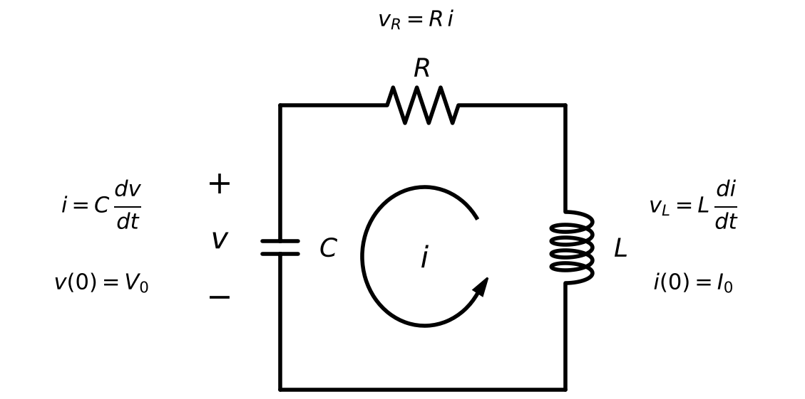
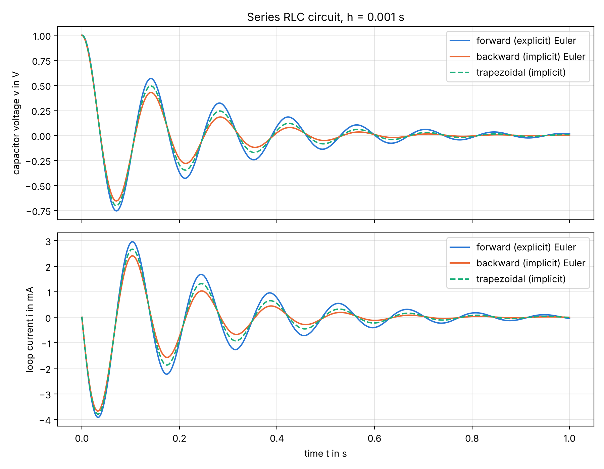
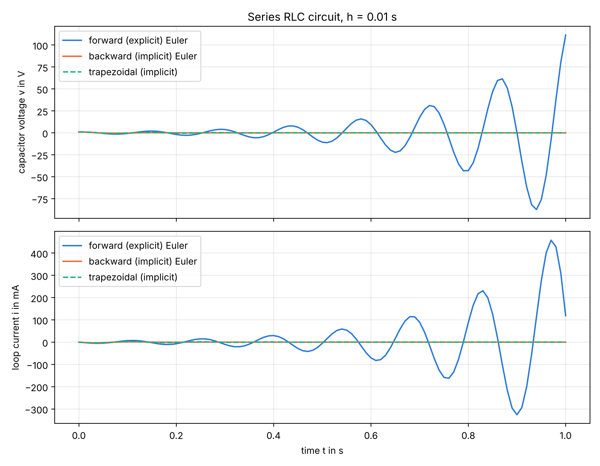
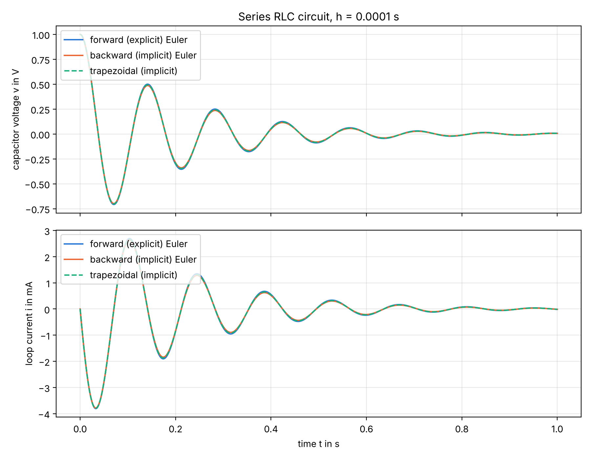

Slide references ("slide N") point to the lecture *Part 3: Continuous models: Ordinary differential equations*. The methods are explained in the concept sheets: `week 6/ps6_concepts.md` for circuits, backward Euler, the trapezoidal method and stability, and `week 5/ps_5_concepts.md` for the workflow and forward Euler.

# 1(a) Abstraction (2P)

{width=75%}

**Circuit.** A resistor $R$, an inductor $L$ and a capacitor $C$ are connected in series in a single loop. There is no voltage or current source.

**Labels and conventions:**

- **Loop current $i$:** one current flows through all three elements because they are in series. Its positive direction is the arrow in the diagram.
- **Output voltage $v$:** the voltage across the capacitor, with $+$ at the top plate. The current arrow enters the capacitor at $+$, so the passive sign convention holds for all three elements.
- **Initial values:** the capacitor is charged to $v(0) = V_0$, and the inductor carries $i(0) = I_0$.

**Quantities and parameters:**

| Symbol | Meaning | Unit | Value in (d) |
|:-:|:--|:-:|:-:|
| $t$ | time (independent variable) | s | $0 \le t \le 1$ |
| $v(t)$ | capacitor voltage (output, state variable) | V | |
| $i(t)$ | loop current (output, state variable) | A | |
| $R$ | resistance | Ω | 50 |
| $L$ | inductance | H | 5 |
| $C$ | capacitance | F | $10^{-4}$ |
| $V_0$ | initial capacitor voltage | V | 1 |
| $I_0$ | initial inductor current | A | 0 |

**Assumptions:** ideal, linear elements ($R$, $L$ and $C$ are constant); the connecting wires have no resistance, inductance or capacitance; no external source; lumped circuit (the voltage law holds at every instant).

**Goal:** compute the capacitor voltage $v(t)$ and the loop current $i(t)$ for $t \ge 0$.

# 1(b) Mathematical model (4P)

**Element laws** (slide 8), with the passive sign convention:
$$
v_R = R\,i, \qquad v_L = L\,\frac{di}{dt}, \qquad i = C\,\frac{dv}{dt}.
$$

**Kirchhoff's voltage law** (slide 8). Walk around the loop in the direction of $i$. Every element is a voltage drop:
$$
v_R + v_L + v = 0
\quad\Longrightarrow\quad
R\,i + L\,\frac{di}{dt} + v = 0 .
$$

**ODE for the output voltage $v$:** solve the capacitor law for $dv/dt$.

**ODE for the loop current $i$:** solve KVL for $di/dt$.

$$
\boxed{\;
\begin{aligned}
\frac{dv}{dt} &= \frac{1}{C}\,i, & v(0) &= V_0,\\[4pt]
\frac{di}{dt} &= -\frac{1}{L}\,v - \frac{R}{L}\,i, & i(0) &= I_0 .
\end{aligned}
\;}
$$

This is a closed set of two first-order ODEs for two unknowns. It is linear, autonomous and homogeneous (no source term), as expected for a passive circuit without a source.

**Matrix form**, with $\vec x = (v,\,i)^T$:
$$
\frac{d\vec x}{dt} = A\,\vec x,\qquad
A = \begin{pmatrix} 0 & \dfrac1C \\[6pt] -\dfrac1L & -\dfrac RL\end{pmatrix}
= \begin{pmatrix} 0 & 10^4 \\ -0.2 & -10\end{pmatrix}\ \text{for the values in (d)}.
$$

**Check against the second-order form.** Differentiating the second equation and inserting $\dot v = i/C$ gives $\ddot i + \frac RL\,\dot i + \frac{1}{LC}\,i = 0$: a damped oscillator, as on slides 7 and 8.

# 1(c) Discretization (6P)

Use the time grid $t_n = n\,h$ for $n = 0, 1, \dots, N$, with $v_n \approx v(t_n)$, $i_n \approx i(t_n)$ and the start values $v_0 = V_0$, $i_0 = I_0$.

## (i) Forward (explicit) Euler

Both right-hand sides are evaluated at the **old** time $t_n$:
$$
\boxed{\;
\begin{aligned}
v_{n+1} &= v_n + \frac{h}{C}\,i_n\\
i_{n+1} &= i_n - \frac{h}{L}\left(v_n + R\,i_n\right)
\end{aligned}
\;}
\qquad\Longleftrightarrow\qquad
\vec x_{n+1} = (I + hA)\,\vec x_n .
$$

Everything on the right is known, so each step is a direct calculation.

## (ii) Backward (implicit) Euler

Both right-hand sides are evaluated at the **new** time $t_{n+1}$:
$$
v_{n+1} = v_n + \frac{h}{C}\,i_{n+1},\qquad
i_{n+1} = i_n - \frac{h}{L}\left(v_{n+1} + R\,i_{n+1}\right)
\qquad\Longleftrightarrow\qquad
(I - hA)\,\vec x_{n+1} = \vec x_n .
$$

The unknowns appear on both sides, so the 2×2 linear system has to be solved in every step. Substitute the first equation into the second:
$$
i_{n+1} = i_n - \frac hL v_n - \frac{h^2}{LC}\,i_{n+1} - \frac{hR}{L}\,i_{n+1}
\quad\Longrightarrow\quad
i_{n+1}\left(1 + \frac{hR}{L} + \frac{h^2}{LC}\right) = i_n - \frac hL\,v_n .
$$

**Update formulas:** first compute $i_{n+1}$, then use it for $v_{n+1}$:
$$
\boxed{\;
\begin{aligned}
i_{n+1} &= \frac{i_n - \dfrac hL\,v_n}{1 + \dfrac{hR}{L} + \dfrac{h^2}{LC}}\\[6pt]
v_{n+1} &= v_n + \frac{h}{C}\,i_{n+1}
\end{aligned}
\;}
$$

## (iii) Trapezoidal (implicit) method

The right-hand sides are the **average** of the old and the new values:
$$
v_{n+1} = v_n + \frac{h}{2C}\left(i_n + i_{n+1}\right),\qquad
i_{n+1} = i_n - \frac{h}{2L}\Big[(v_n + v_{n+1}) + R\,(i_n + i_{n+1})\Big]
$$
$$
\Longleftrightarrow\qquad
\left(I - \tfrac h2 A\right)\vec x_{n+1} = \left(I + \tfrac h2 A\right)\vec x_n .
$$

Again, substitute the first equation into the second. With $v_n + v_{n+1} = 2v_n + \frac{h}{2C}(i_n + i_{n+1})$:
$$
i_{n+1} = i_n - \frac hL\,v_n - \left(\frac{h^2}{4LC} + \frac{hR}{2L}\right)(i_n + i_{n+1}).
$$

Define $a = \dfrac{hR}{2L} + \dfrac{h^2}{4LC}$ and collect the $i_{n+1}$ terms.

**Update formulas:**
$$
\boxed{\;
\begin{aligned}
i_{n+1} &= \frac{(1 - a)\,i_n - \dfrac hL\,v_n}{1 + a}\\[6pt]
v_{n+1} &= v_n + \frac{h}{2C}\left(i_n + i_{n+1}\right)
\end{aligned}
\;}
$$

All three schemes are now explicit formulas in the code, so no matrix solver is needed inside the loop.

# 1(d) Programming (4P + 1P)

The program runs all three methods in one `for` loop over the time steps, with separate arrays for each method. For part (e) it also computes the analytical solution (concept sheet section 7) and repeats the run with other step sizes.

**Program** (`ps6_ex1d_MATRNR.py`, also as the notebook `ps6_ex1d_MATRNR.ipynb`):

```python
"""Problem sheet 6, exercise 1(d).

Series RLC circuit without a source.
State variables: capacitor voltage v and loop current i.

    dv/dt = i / C
    di/dt = -(v + R i) / L

solved with forward Euler, backward Euler and the trapezoidal method.
"""
import numpy as np
import matplotlib.pyplot as plt

# ---------------- parameters ----------------
R = 50.0        # resistance in Ohm
L = 5.0         # inductance in H
C = 0.0001      # capacitance in F
V0 = 1.0        # initial capacitor voltage in V
I0 = 0.0        # initial inductor (loop) current in A
t_end = 1.0     # end time in s


def simulate(h):
    """Return t and (v, i) for the three methods with step size h."""
    t = np.arange(0, t_end + h / 2, h)
    N = len(t)

    # arrays for the three methods
    v_fe = np.zeros(N); i_fe = np.zeros(N)     # forward Euler
    v_be = np.zeros(N); i_be = np.zeros(N)     # backward Euler
    v_tr = np.zeros(N); i_tr = np.zeros(N)     # trapezoidal

    # initial conditions
    v_fe[0] = V0; i_fe[0] = I0
    v_be[0] = V0; i_be[0] = I0
    v_tr[0] = V0; i_tr[0] = I0

    # constants for the implicit methods (the 2x2 system is solved by hand)
    d_be = 1 + h * R / L + h**2 / (L * C)
    a_tr = h * R / (2 * L) + h**2 / (4 * L * C)

    for n in range(N - 1):
        # (i) forward Euler: slopes at the OLD time step
        v_fe[n + 1] = v_fe[n] + h * i_fe[n] / C
        i_fe[n + 1] = i_fe[n] - h * (v_fe[n] + R * i_fe[n]) / L

        # (ii) backward Euler: slopes at the NEW time step
        i_be[n + 1] = (i_be[n] - h * v_be[n] / L) / d_be
        v_be[n + 1] = v_be[n] + h * i_be[n + 1] / C

        # (iii) trapezoidal: average of the OLD and NEW slopes
        i_tr[n + 1] = ((1 - a_tr) * i_tr[n] - h * v_tr[n] / L) / (1 + a_tr)
        v_tr[n + 1] = v_tr[n] + h * (i_tr[n] + i_tr[n + 1]) / (2 * C)

    return t, (v_fe, i_fe), (v_be, i_be), (v_tr, i_tr)


def exact(t):
    """Analytical solution of the underdamped circuit (for verification)."""
    alpha = R / (2 * L)                       # damping rate in 1/s
    w0 = 1 / np.sqrt(L * C)                   # undamped angular frequency
    wd = np.sqrt(w0**2 - alpha**2)            # damped angular frequency
    B = (alpha * V0 + I0 / C) / wd
    v = np.exp(-alpha * t) * (V0 * np.cos(wd * t) + B * np.sin(wd * t))
    i = C * np.exp(-alpha * t) * ((wd * B - alpha * V0) * np.cos(wd * t)
                                  - (alpha * B + wd * V0) * np.sin(wd * t))
    return v, i


# ---------------- main run with h = 0.001 s ----------------
h = 0.001
t, fe, be, tr = simulate(h)
v_ex, i_ex = exact(t)

alpha = R / (2 * L)
w0 = 1 / np.sqrt(L * C)
print(f"alpha = {alpha} 1/s, omega0 = {w0:.3f} rad/s, "
      f"omega_d = {np.sqrt(w0**2 - alpha**2):.3f} rad/s -> underdamped")
print(f"period T_d = {2 * np.pi / np.sqrt(w0**2 - alpha**2):.4f} s\n")

print(f"h = {h} s: values at t = 1 s")
print(f"{'method':>16} {'v (V)':>11} {'i (mA)':>10}")
for name, (v, i) in (("forward Euler", fe), ("backward Euler", be),
                     ("trapezoidal", tr)):
    print(f"{name:>16} {v[-1]:>11.6f} {1000 * i[-1]:>10.5f}")
print(f"{'exact':>16} {v_ex[-1]:>11.6f} {1000 * i_ex[-1]:>10.5f}")

# ---------------- plot: two subplots, three methods each ----------------
fig, (ax1, ax2) = plt.subplots(2, 1, figsize=(9, 7), sharex=True)

ax1.plot(t, fe[0], color="#2a78d6", label="forward (explicit) Euler")
ax1.plot(t, be[0], color="#eb6834", label="backward (implicit) Euler")
ax1.plot(t, tr[0], color="#1baf7a", ls="--", label="trapezoidal (implicit)")
ax1.set_ylabel("capacitor voltage v in V")
ax1.set_title(f"Series RLC circuit, h = {h} s")
ax1.legend(loc="upper right")
ax1.grid(alpha=0.3)

ax2.plot(t, 1000 * fe[1], color="#2a78d6", label="forward (explicit) Euler")
ax2.plot(t, 1000 * be[1], color="#eb6834", label="backward (implicit) Euler")
ax2.plot(t, 1000 * tr[1], color="#1baf7a", ls="--", label="trapezoidal (implicit)")
ax2.set_xlabel("time t in s")
ax2.set_ylabel("loop current i in mA")
ax2.legend(loc="upper right")
ax2.grid(alpha=0.3)

fig.tight_layout()
fig.savefig("ps6_ex1d_plot_h0.001.png", dpi=200)
plt.show()

# ---------------- part (e): other step sizes ----------------
print("\nmaximum error over 0 <= t <= 1 s compared with the exact solution")
print(f"{'h (s)':>8} {'FE: max|v-v_ex|':>16} {'BE: max|v-v_ex|':>16} "
      f"{'TR: max|v-v_ex|':>16}")
for hh in (0.01, 0.001, 0.0001):
    tt, f1, b1, t1 = simulate(hh)
    ve, ie = exact(tt)
    errs = [np.max(np.abs(m[0] - ve)) for m in (f1, b1, t1)]
    print(f"{hh:>8} {errs[0]:>16.3e} {errs[1]:>16.3e} {errs[2]:>16.3e}")

# energy check E = C v^2 / 2 + L i^2 / 2 must never increase (dE/dt = -R i^2)
for name, (v, i) in (("forward Euler", fe), ("backward Euler", be),
                     ("trapezoidal", tr)):
    E = 0.5 * C * v**2 + 0.5 * L * i**2
    print(f"{name:>16}: E(1 s)/E(0) = {E[-1] / E[0]:.3e}")
E_ex = 0.5 * C * v_ex**2 + 0.5 * L * i_ex**2
print(f"{'exact':>16}: E(1 s)/E(0) = {E_ex[-1] / E_ex[0]:.3e}")

# the same plot for h = 0.01 s and h = 0.0001 s
for hh in (0.01, 0.0001):
    tt, f1, b1, t1 = simulate(hh)
    fig, (ax1, ax2) = plt.subplots(2, 1, figsize=(9, 7), sharex=True)
    for ax, k, scale, lab in ((ax1, 0, 1, "capacitor voltage v in V"),
                              (ax2, 1, 1000, "loop current i in mA")):
        ax.plot(tt, scale * f1[k], color="#2a78d6", label="forward (explicit) Euler")
        ax.plot(tt, scale * b1[k], color="#eb6834", label="backward (implicit) Euler")
        ax.plot(tt, scale * t1[k], color="#1baf7a", ls="--", label="trapezoidal (implicit)")
        ax.set_ylabel(lab)
        ax.legend(loc="upper left")
        ax.grid(alpha=0.3)
    ax1.set_title(f"Series RLC circuit, h = {hh} s")
    ax2.set_xlabel("time t in s")
    fig.tight_layout()
    fig.savefig(f"ps6_ex1d_plot_h{hh}.png", dpi=200)
    plt.show()
```

**Output:**

```text
alpha = 5.0 1/s, omega0 = 44.721 rad/s, omega_d = 44.441 rad/s -> underdamped
period T_d = 0.1414 s

h = 0.001 s: values at t = 1 s
          method       v (V)     i (mA)
   forward Euler    0.015554   -0.04924
  backward Euler    0.002573   -0.00240
     trapezoidal    0.006409   -0.01327
           exact    0.006377   -0.01343

maximum error over 0 <= t <= 1 s compared with the exact solution
   h (s)  FE: max|v-v_ex|  BE: max|v-v_ex|  TR: max|v-v_ex|
    0.01        1.114e+02        3.793e-01        5.347e-02
   0.001        8.236e-02        6.671e-02        5.458e-04
  0.0001        7.474e-03        7.319e-03        5.459e-06
   forward Euler: E(1 s)/E(0) = 3.631e-04
  backward Euler: E(1 s)/E(0) = 6.907e-06
     trapezoidal: E(1 s)/E(0) = 4.987e-05
           exact: E(1 s)/E(0) = 4.968e-05
```

## Plot for $h = 0.001$ s

{width=100%}

# 1(e) Interpretation (3P)

## What the circuit does

With the given values,
$$
\alpha = \frac{R}{2L} = 5\ \text{s}^{-1},\qquad
\omega_0 = \frac{1}{\sqrt{LC}} = 44.72\ \text{rad/s},\qquad
\omega_d = \sqrt{\omega_0^2 - \alpha^2} = 44.44\ \text{rad/s}.
$$

Since $\alpha < \omega_0$, the circuit is **underdamped**. The energy stored in the capacitor swings back and forth between the capacitor (electric field) and the inductor (magnetic field), and the resistor turns a part of it into heat in every cycle.

- The period is $T_d = 2\pi/\omega_d = 0.141$ s, so about 7 oscillations fit into 1 s.
- The amplitude decays like $e^{-5t}$, to $e^{-5} \approx 0.7\,\%$ of $V_0$ after 1 s.

## Plausibility

All three curves for $h = 0.001$ s pass these checks:

1. **Initial values.** $v(0) = 1$ V and $i(0) = 0$ $\checkmark$.
2. **Initial slopes.** $\dot v(0) = I_0/C = 0$ (the voltage curve starts flat) and $\dot i(0) = -V_0/L = -0.2$ A/s, so the current starts negative $\checkmark$. A negative $i$ means that the capacitor discharges by pushing current out of its $+$ plate, which is physically right.
3. **Period.** The maxima of $v$ are about 0.14 s apart $\checkmark$.
4. **Phase.** $i$ is zero exactly where $v$ has a maximum or minimum, because $i = C\,dv/dt$ $\checkmark$.
5. **Decay.** Without a source, both $v$ and $i$ go to zero $\checkmark$, and the stored energy decreases for all three methods $\checkmark$.
6. **Size of the current.** The amplitude is $V_0\sqrt{C/L} \approx 4.5$ mA without damping; the first minimum of $i$ is about $-3.7$ mA $\checkmark$.

## Verification

The analytical solution of the underdamped circuit (concept sheet section 7) was checked independently with SciPy's high-accuracy ODE solver; the two agree to all printed digits.

**Values at $t = 1$ s with $h = 0.001$ s:**

| Method | $v(1\,\text{s})$ (V) | $i(1\,\text{s})$ (mA) | error in $v$ |
|:--|:-:|:-:|:-:|
| forward Euler | 0.015554 | −0.04924 | $+9.2\times10^{-3}$ |
| backward Euler | 0.002573 | −0.00240 | $-3.8\times10^{-3}$ |
| trapezoidal | 0.006409 | −0.01327 | $+3.2\times10^{-5}$ |
| exact | 0.006377 | −0.01343 | |

**Maximum error in $v$ over $0 \le t \le 1$ s:**

| $h$ (s) | forward Euler | backward Euler | trapezoidal |
|:-:|:-:|:-:|:-:|
| 0.01 | $1.1\times10^{2}$ (unstable) | $3.8\times10^{-1}$ | $5.3\times10^{-2}$ |
| 0.001 | $8.2\times10^{-2}$ | $6.7\times10^{-2}$ | $5.5\times10^{-4}$ |
| 0.0001 | $7.5\times10^{-3}$ | $7.3\times10^{-3}$ | $5.5\times10^{-6}$ |

- **Forward and backward Euler:** $h$ ten times smaller gives an error about 10 times smaller. That is first order, $\mathcal O(h)$ $\checkmark$.
- **Trapezoidal:** $h$ ten times smaller gives an error 100 times smaller. That is second order, $\mathcal O(h^2)$ $\checkmark$.

The measured orders match the theory, which verifies the implementation of all three methods.

## Validation

The model uses ideal elements. A real circuit also has resistance in the wires and in the coil, a coil with some capacitance between its windings, and components with tolerances. For example, extra wire resistance would increase $\alpha$, so the real circuit would decay a little faster.

To validate the model, one would measure $v(t)$ with an oscilloscope and compare the period and the decay rate with $T_d = 0.141$ s and $\alpha = 5\ \text{s}^{-1}$. For a damped LC oscillation of this kind, the ideal RLC model is the standard, well-tested description.

## Difference between the three methods

The amplification factor per step for the eigenvalues $\lambda = -\alpha \pm i\,\omega_d$ of $A$ (concept sheet section 6) explains the plot:

| Method | $\lvert G\rvert$ per step, $h = 0.001$ s | $\lvert G\rvert^{1000}$ (amplitude after 1 s) | Effect |
|:--|:-:|:-:|:--|
| exact | 0.995012 | $6.7\times10^{-3}$ | |
| forward Euler | 0.995992 | $1.8\times10^{-2}$ | decays **too slowly** |
| backward Euler | 0.994053 | $2.6\times10^{-3}$ | decays **too fast** (numerical damping) |
| trapezoidal | 0.995015 | $6.8\times10^{-3}$ | almost exact |

- **Forward Euler** follows the tangent at the start of each step. For a rotating (oscillating) solution, the tangent always points slightly outward, so the method adds a little energy in every step. That is why its amplitude is too large in the plot, and why its energy after 1 s is about 7 times the exact value.
- **Backward Euler** uses the slope at the end of the step, which points slightly inward. It removes energy and damps the oscillation too strongly: its amplitude is too small, and its energy after 1 s is only about $1/7$ of the exact value.
- **Trapezoidal** averages the two slopes. The two errors cancel to first order, so it follows the exact solution closely. At $h = 0.001$ s its curve could not be told apart from the exact solution in the plot (difference below $6\times10^{-4}$ V).

All three methods reproduce the frequency well at $h = 0.001$ s; the main visible difference is the amplitude.

## Changing the step size

{width=100%}

**$h = 0.01$ s.**

- **Forward Euler becomes unstable.** Its stability condition is
$$
h < \frac{2\alpha}{\alpha^2 + \omega_d^2} = \frac{10}{2000} = 0.005\ \text{s}.
$$
At $h = 0.01$ s the amplification factor is $|G| = 1.049 > 1$, so the amplitude **grows** by about 5 % per step. After 100 steps the voltage reaches more than 100 V, which is physically impossible for a passive circuit that started with 1 V.
- **Backward Euler stays stable** but damps far too much. Its amplitude after 1 s is about 3000 times too small, so the oscillation almost disappears.
- **The trapezoidal method stays stable and accurate.** Its maximum error is 0.05 V, and its amplitude after 1 s is only 26 % too large.

This illustrates the main advantage of the implicit methods: **they stay stable for any step size**. Forward Euler can only be used with $h < 0.005$ s here.

{width=100%}

**$h = 0.0001$ s.** All three methods are stable and accurate, and the curves almost coincide. The two Euler methods still have errors of about $7\times10^{-3}$ V, while the trapezoidal method is accurate to about $5\times10^{-6}$ V. Forward and backward Euler need 10 times more steps (and still have a larger error) than the trapezoidal method needs at $h = 0.001$ s.

## Conclusions

1. The series RLC circuit with these values is an underdamped oscillator: $v$ and $i$ oscillate with a period of 0.141 s inside an envelope $e^{-5t}$, and both decay to zero because the resistor dissipates the stored energy.
2. All three methods are verified: they converge to the exact solution with the expected orders (1, 1 and 2).
3. **Forward Euler** is the simplest, but it overestimates the amplitude and is unstable for $h > 0.005$ s.
4. **Backward Euler** is always stable, but adds artificial damping, so it underestimates the amplitude.
5. **The trapezoidal method** costs about the same as backward Euler, is always stable, and is by far the most accurate. It is the best of the three for this oscillating circuit.
