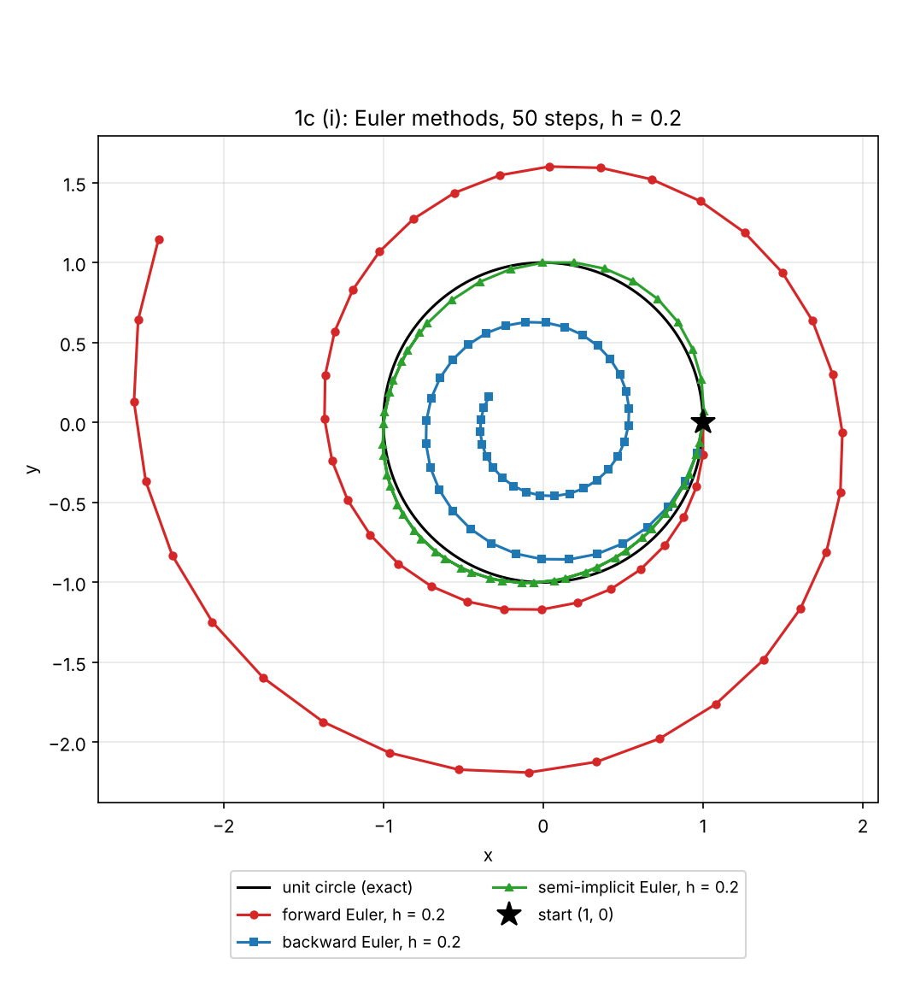
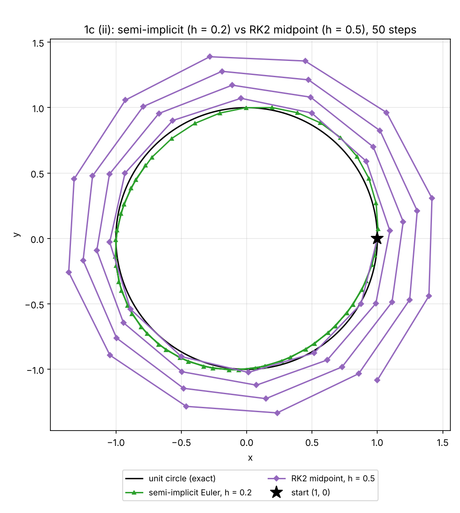
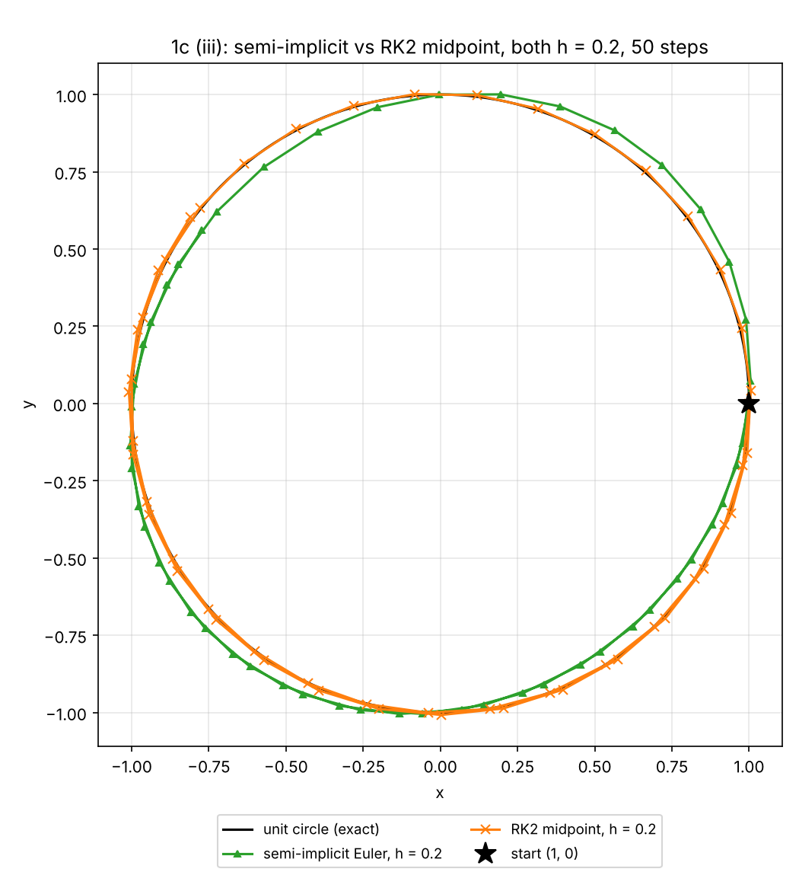
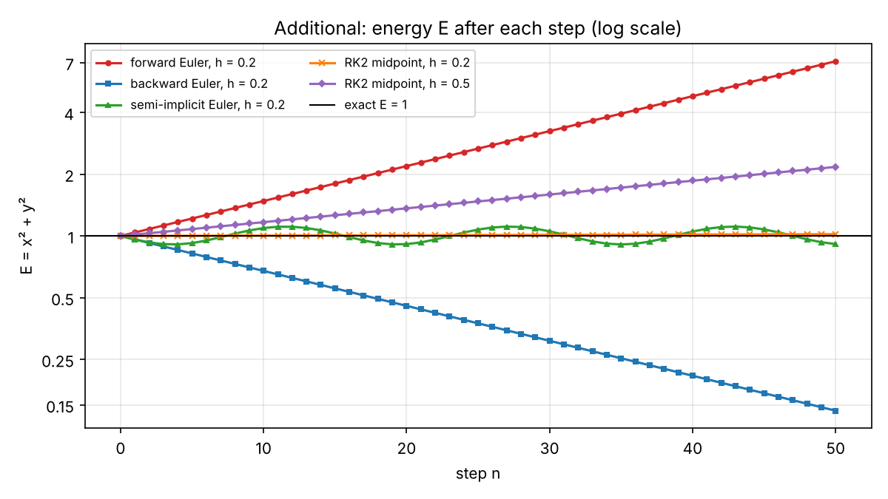

Slide references point to the lecture *Part 3: Continuous models: Ordinary differential equations*, sections 9.2 to 9.7. The methods are explained in the concept sheets: `week 7/ps7_concepts.md` (conserved quantities, phase plane, semi-implicit Euler, RK2, energy behaviour), `week 6/ps6_concepts.md` (backward Euler, stability, amplification factor) and `week 5/ps_5_concepts.md` (forward Euler).

**Problem.**
$$
x'(t) = y(t),\qquad y'(t) = -x(t),\qquad x(0) = 1,\quad y(0) = 0 .
$$

In matrix form, with $\vec u = (x, y)^T$:
$$
\vec u' = A\,\vec u,\qquad A = \begin{pmatrix} 0 & 1\\ -1 & 0\end{pmatrix},\qquad \text{eigenvalues } \lambda = \pm i .
$$

This is the harmonic oscillator $x'' = -x$ written as a first-order system ($y = x'$). Its exact solution is $x(t) = \cos t$, $y(t) = -\sin t$.

# 1(a) Conserved quantity and its geometry

## (i) $E = x^2 + y^2$ is conserved

Differentiate $E$ along a solution with the chain rule and insert the ODE:
$$
\frac{dE}{dt} = 2x\,x' + 2y\,y' = 2x\,(y) + 2y\,(-x) = 2xy - 2xy = 0 .
$$

The derivative is zero for **every** point $(x, y)$, so $E\big(x(t), y(t)\big)$ is constant in time:
$$
E(t) = E(0) = x(0)^2 + y(0)^2 = 1^2 + 0^2 = 1 .
$$

*Check with the exact solution:* $\cos^2 t + \sin^2 t = 1$ $\checkmark$.

## (ii) Geometrical object

The set $x^2 + y^2 = c$ (with $c > 0$) is a **circle** in the $(x, y)$ plane with centre $(0, 0)$ and radius $r = \sqrt c$.

Here $c = E(0) = 1$, so the exact trajectory is the **unit circle**. It starts at $(1, 0)$, where the velocity is $(x', y') = (0, -1)$, so the point moves **clockwise** and completes one round in $T = 2\pi \approx 6.28$ time units.

Consequence for the numerics: the distance $\sqrt{x_n^2 + y_n^2}$ of a numerical point from the origin shows the energy error directly. A correct method must stay on the unit circle.

# 1(b) Numerical schemes and implementation

Grid: $t_n = n\,h$, $n = 0, \dots, 50$ (50 steps give 51 points), $x_n \approx x(t_n)$, $y_n \approx y(t_n)$, $x_0 = 1$, $y_0 = 0$.

## (i) Forward (explicit) Euler

Both slopes are evaluated at the old point (slide "Forward Euler scheme"):
$$
\boxed{\;x_{n+1} = x_n + h\,y_n,\qquad y_{n+1} = y_n - h\,x_n\;}
\qquad\Longleftrightarrow\qquad \vec u_{n+1} = (I + hA)\,\vec u_n .
$$

## (ii) Backward (implicit) Euler

Both slopes are evaluated at the new point:
$$
x_{n+1} = x_n + h\,y_{n+1},\qquad y_{n+1} = y_n - h\,x_{n+1}
\qquad\Longleftrightarrow\qquad (I - hA)\,\vec u_{n+1} = \vec u_n .
$$

The unknowns appear on both sides, so solve the 2×2 linear system by hand. Insert the second equation into the first:
$$
x_{n+1} = x_n + h\,(y_n - h\,x_{n+1})
\;\Longrightarrow\;
x_{n+1}\,(1 + h^2) = x_n + h\,y_n ,
$$
and similarly for $y_{n+1}$:
$$
\boxed{\;x_{n+1} = \frac{x_n + h\,y_n}{1 + h^2},\qquad y_{n+1} = \frac{y_n - h\,x_n}{1 + h^2}\;}
$$

## (iii) Semi-implicit Euler (Euler-Cromer)

Lecture 9.6 form: $v' = f(y)$, $y' = g(v)$. Here $y$ plays the role of the velocity $v$ (because $x' = y$) and $x$ the role of the position. First a forward step for $y$, then a step for $x$ with the **new** $y$:
$$
\boxed{\;y_{n+1} = y_n - h\,x_n,\qquad x_{n+1} = x_n + h\,y_{n+1}\;}
$$

No equation has to be solved, because $y_{n+1}$ is known before it is used.

## (iv) Second-order Runge-Kutta (midpoint) method

Lecture 9.7, applied to both components at once:
$$
\begin{aligned}
k_1^x &= y_n, & k_1^y &= -x_n && \text{slope at the start}\\
x_{mid} &= x_n + \tfrac h2\,k_1^x, & y_{mid} &= y_n + \tfrac h2\,k_1^y && \text{half Euler step}\\
k_2^x &= y_{mid}, & k_2^y &= -x_{mid} && \text{slope at the midpoint}\\
x_{n+1} &= x_n + h\,k_2^x, & y_{n+1} &= y_n + h\,k_2^y && \text{full step}
\end{aligned}
$$

Written out, this is (useful for checking):
$$
x_{n+1} = \left(1 - \tfrac{h^2}{2}\right)x_n + h\,y_n,\qquad
y_{n+1} = \left(1 - \tfrac{h^2}{2}\right)y_n - h\,x_n
\qquad\Longleftrightarrow\qquad
\vec u_{n+1} = \left(I + hA + \tfrac{h^2}{2}A^2\right)\vec u_n ,
$$
because $A^2 = -I$.

## First two steps by hand ($h = 0.2$)

| $n$ | forward Euler | backward Euler | semi-implicit | RK2 midpoint | exact $(\cos t, -\sin t)$ |
|:-:|:-:|:-:|:-:|:-:|:-:|
| 0 | (1, 0) | (1, 0) | (1, 0) | (1, 0) | (1, 0) |
| 1 | (1.0000, −0.2000) | (0.9615, −0.1923) | (0.9600, −0.2000) | (0.9800, −0.2000) | (0.9801, −0.1987) |
| 2 | (0.9600, −0.4000) | (0.8876, −0.3698) | (0.8816, −0.3920) | (0.9204, −0.3920) | (0.9211, −0.3894) |
| $E_2$ | 1.0816 | 0.9246 | 0.9309 | 1.0008 | 1 |

These numbers are reproduced exactly by the program and are a quick check that each scheme is coded correctly.

## Program

(`ps7_ex1_MATRNR.py`, also as the executed notebook `ps7_ex1_MATRNR.ipynb`; rename `MATRNR` to your matriculation number before uploading.)

```python
"""Problem sheet 7, exercise 1(b)-(d).

Harmonic oscillator written as a system of two first-order ODEs

    x'(t) = y(t),    y'(t) = -x(t),    x(0) = 1,  y(0) = 0

solved with
    (i)   forward (explicit) Euler
    (ii)  backward (implicit) Euler
    (iii) semi-implicit Euler (Euler-Cromer)
    (iv)  2nd order Runge-Kutta (midpoint) method

Exact solution: x(t) = cos t, y(t) = -sin t, i.e. the unit circle,
and E = x^2 + y^2 = 1 for all t.
"""
import numpy as np
import matplotlib.pyplot as plt

# ---------------- parameters ----------------
N = 50            # number of time steps (50 steps -> 51 points incl. the start)
h = 0.2           # step size for the Euler methods and the first RK2 run
h_big = 0.5       # larger step size for the second RK2 run
x0, y0 = 1.0, 0.0 # initial conditions x(0) = 1, y(0) = 0

# ---------------- arrays for all methods ----------------
# index n holds the approximation at t_n = n*h, so N steps need N+1 entries
x_fe = np.zeros(N + 1); y_fe = np.zeros(N + 1)   # (i)   forward Euler,  h = 0.2
x_be = np.zeros(N + 1); y_be = np.zeros(N + 1)   # (ii)  backward Euler, h = 0.2
x_si = np.zeros(N + 1); y_si = np.zeros(N + 1)   # (iii) semi-implicit,  h = 0.2
x_rk = np.zeros(N + 1); y_rk = np.zeros(N + 1)   # (iv)  RK2 midpoint,   h = 0.2
x_rk5 = np.zeros(N + 1); y_rk5 = np.zeros(N + 1) # (iv)  RK2 midpoint,   h = 0.5

# initial conditions: every method starts at the same point (1, 0)
for xa, ya in ((x_fe, y_fe), (x_be, y_be), (x_si, y_si),
               (x_rk, y_rk), (x_rk5, y_rk5)):
    xa[0] = x0
    ya[0] = y0

# ---------------- time stepping ----------------
for n in range(N):
    # (i) forward Euler: both slopes are taken at the OLD point (x_n, y_n)
    x_fe[n + 1] = x_fe[n] + h * y_fe[n]          # x' =  y
    y_fe[n + 1] = y_fe[n] - h * x_fe[n]          # y' = -x

    # (ii) backward Euler: both slopes are taken at the NEW point
    #      x_{n+1} = x_n + h y_{n+1},  y_{n+1} = y_n - h x_{n+1}
    #      This 2x2 linear system was solved by hand (solution sheet 1(b)):
    x_be[n + 1] = (x_be[n] + h * y_be[n]) / (1 + h**2)
    y_be[n + 1] = (y_be[n] - h * x_be[n]) / (1 + h**2)

    # (iii) semi-implicit Euler (Euler-Cromer, lecture 9.6):
    #       first update y with the OLD x (forward step) ...
    y_si[n + 1] = y_si[n] - h * x_si[n]
    #       ... then update x with the NEW y (backward step), no equation to solve
    x_si[n + 1] = x_si[n] + h * y_si[n + 1]

    # (iv) RK2 midpoint, h = 0.2
    #      k1: slope at the start of the step
    k1x = y_rk[n]
    k1y = -x_rk[n]
    #      half Euler step to the midpoint t_n + h/2
    x_mid = x_rk[n] + 0.5 * h * k1x
    y_mid = y_rk[n] + 0.5 * h * k1y
    #      k2: slope at the midpoint, used for the full step
    k2x = y_mid
    k2y = -x_mid
    x_rk[n + 1] = x_rk[n] + h * k2x
    y_rk[n + 1] = y_rk[n] + h * k2y

    # (iv) RK2 midpoint, h = 0.5 (same scheme, larger step)
    k1x = y_rk5[n]
    k1y = -x_rk5[n]
    x_mid = x_rk5[n] + 0.5 * h_big * k1x
    y_mid = y_rk5[n] + 0.5 * h_big * k1y
    k2x = y_mid
    k2y = -x_mid
    x_rk5[n + 1] = x_rk5[n] + h_big * k2x
    y_rk5[n + 1] = y_rk5[n] + h_big * k2y

# ---------------- energy E = x^2 + y^2 (exact value: 1) ----------------
E_fe = x_fe**2 + y_fe**2
E_be = x_be**2 + y_be**2
E_si = x_si**2 + y_si**2
E_rk = x_rk**2 + y_rk**2
E_rk5 = x_rk5**2 + y_rk5**2

print(f"{'method':>28} {'t_end':>6} {'E(t_end)':>9} {'min E':>7} {'max E':>7}"
      f" {'radius':>7}")
for name, T, E in (("forward Euler,   h = 0.2", N * h, E_fe),
                   ("backward Euler,  h = 0.2", N * h, E_be),
                   ("semi-implicit,   h = 0.2", N * h, E_si),
                   ("RK2 midpoint,    h = 0.2", N * h, E_rk),
                   ("RK2 midpoint,    h = 0.5", N * h_big, E_rk5)):
    print(f"{name:>28} {T:>6.1f} {E[-1]:>9.4f} {E.min():>7.4f} {E.max():>7.4f}"
          f" {np.sqrt(E[-1]):>7.4f}")

# unit circle (exact trajectory) for the plots
phi = np.linspace(0, 2 * np.pi, 400)
cx, cy = np.cos(phi), np.sin(phi)

# ---------------- plot 1c (i): the three Euler methods ----------------
fig, ax = plt.subplots(figsize=(7, 7.8))
ax.plot(cx, cy, "k-", lw=1.5, label="unit circle (exact)")
ax.plot(x_fe, y_fe, "o-", color="#d62728", ms=4, label="forward Euler, h = 0.2")
ax.plot(x_be, y_be, "s-", color="#1f77b4", ms=4, label="backward Euler, h = 0.2")
ax.plot(x_si, y_si, "^-", color="#2ca02c", ms=4, label="semi-implicit Euler, h = 0.2")
ax.plot(x0, y0, "k*", ms=14, label="start (1, 0)")
ax.set_aspect("equal")             # a circle must look like a circle
ax.set_xlabel("x"); ax.set_ylabel("y")
ax.set_title("1c (i): Euler methods, 50 steps, h = 0.2")
ax.grid(alpha=0.3)
ax.legend(loc="upper center", bbox_to_anchor=(0.5, -0.09), ncol=2, fontsize=9)
fig.tight_layout()
fig.savefig("ps7_ex1c_i.png", dpi=150)
plt.show()

# ---------------- plot 1c (ii): semi-implicit h=0.2 vs RK2 h=0.5 ----------------
fig, ax = plt.subplots(figsize=(7, 7.8))
ax.plot(cx, cy, "k-", lw=1.5, label="unit circle (exact)")
ax.plot(x_si, y_si, "^-", color="#2ca02c", ms=4, label="semi-implicit Euler, h = 0.2")
ax.plot(x_rk5, y_rk5, "D-", color="#9467bd", ms=4, label="RK2 midpoint, h = 0.5")
ax.plot(x0, y0, "k*", ms=14, label="start (1, 0)")
ax.set_aspect("equal")
ax.set_xlabel("x"); ax.set_ylabel("y")
ax.set_title("1c (ii): semi-implicit (h = 0.2) vs RK2 midpoint (h = 0.5), 50 steps")
ax.grid(alpha=0.3)
ax.legend(loc="upper center", bbox_to_anchor=(0.5, -0.09), ncol=2, fontsize=9)
fig.tight_layout()
fig.savefig("ps7_ex1c_ii.png", dpi=150)
plt.show()

# ---------------- plot 1c (iii): semi-implicit h=0.2 vs RK2 h=0.2 ----------------
fig, ax = plt.subplots(figsize=(7, 7.8))
ax.plot(cx, cy, "k-", lw=1.5, label="unit circle (exact)")
ax.plot(x_si, y_si, "^-", color="#2ca02c", ms=4, label="semi-implicit Euler, h = 0.2")
ax.plot(x_rk, y_rk, "x-", color="#ff7f0e", ms=6, label="RK2 midpoint, h = 0.2")
ax.plot(x0, y0, "k*", ms=14, label="start (1, 0)")
ax.set_aspect("equal")
ax.set_xlabel("x"); ax.set_ylabel("y")
ax.set_title("1c (iii): semi-implicit vs RK2 midpoint, both h = 0.2, 50 steps")
ax.grid(alpha=0.3)
ax.legend(loc="upper center", bbox_to_anchor=(0.5, -0.09), ncol=2, fontsize=9)
fig.tight_layout()
fig.savefig("ps7_ex1c_iii.png", dpi=150)
plt.show()

# ---------------- additional figure for 1(d): E over the step number ----------------
fig, ax = plt.subplots(figsize=(8, 4.5))
n_steps = np.arange(N + 1)
ax.plot(n_steps, E_fe, "o-", color="#d62728", ms=3, label="forward Euler, h = 0.2")
ax.plot(n_steps, E_be, "s-", color="#1f77b4", ms=3, label="backward Euler, h = 0.2")
ax.plot(n_steps, E_si, "^-", color="#2ca02c", ms=3, label="semi-implicit Euler, h = 0.2")
ax.plot(n_steps, E_rk, "x-", color="#ff7f0e", ms=4, label="RK2 midpoint, h = 0.2")
ax.plot(n_steps, E_rk5, "D-", color="#9467bd", ms=3, label="RK2 midpoint, h = 0.5")
ax.axhline(1.0, color="k", lw=1, label="exact E = 1")
ax.set_yscale("log")
ticks = [0.15, 0.25, 0.5, 1, 2, 4, 7]
ax.set_yticks(ticks); ax.set_yticklabels([str(v) for v in ticks]); ax.minorticks_off()
ax.set_xlabel("step n"); ax.set_ylabel("E = x² + y²")
ax.set_title("Additional: energy E after each step (log scale)")
ax.grid(alpha=0.3); ax.legend(fontsize=8, ncol=2)
fig.tight_layout()
fig.savefig("ps7_ex1d_energy.png", dpi=150)
plt.show()
```

**Output:**

```text
                      method  t_end  E(t_end)   min E   max E  radius
    forward Euler,   h = 0.2   10.0    7.1067  1.0000  7.1067  2.6658
    backward Euler,  h = 0.2   10.0    0.1407  0.1407  1.0000  0.3751
    semi-implicit,   h = 0.2   10.0    0.9132  0.9091  1.1110  0.9556
    RK2 midpoint,    h = 0.2   10.0    1.0202  1.0000  1.0202  1.0100
    RK2 midpoint,    h = 0.5   25.0    2.1710  1.0000  2.1710  1.4734
```

# 1(c) Plots

The program draws the three required figures separately. Every method has its own colour **and** marker (one marker per computed point), the start point $(1, 0)$ is marked with a star, and the axes are scaled equally so that the unit circle looks round.

{width=78%}

{width=78%}

{width=78%}

# 1(d) Stability and energy conservation

## What the graphs show

- **Forward Euler** (red, plot (i)): the points **spiral outwards**. Every round has a larger radius; after 50 steps the radius is about 2.7. The motion is unbounded.
- **Backward Euler** (blue, plot (i)): the points **spiral inwards** towards the origin; after 50 steps the radius is only about 0.38. The oscillation is damped although the true system has no damping.
- **Semi-implicit Euler** (green, all plots): the points stay on a **closed curve** very close to the unit circle. It is slightly flattened and tilted (bulging out near $(0.7, 0.7)$ and $(-0.7, -0.7)$, pulled in near $(-0.7, 0.7)$ and $(0.7, -0.7)$), but the curve does **not** move outwards or inwards from round to round.
- **RK2 midpoint, $h = 0.2$** (orange, plot (iii)): the points lie almost exactly on the unit circle; by eye, no drift is visible over 1.6 rounds.
- **RK2 midpoint, $h = 0.5$** (purple, plot (ii)): with only about 12 points per round the trajectory is a coarse polygon that **spirals slowly outwards**; after 4 rounds the radius is about 1.47.

## Quantitative explanation

Every scheme maps $\vec u_n$ to $\vec u_{n+1}$ with a fixed matrix. For forward Euler, backward Euler and RK2 the matrix is a rotation times a factor, so $E$ changes by the **same factor in each step** (concept sheet section 6.2):

| Method | $E_{n+1}/E_n$ | $h$ | factor per step | predicted $E_{50}$ | measured $E_{50}$ |
|:--|:-:|:-:|:-:|:-:|:-:|
| forward Euler | $1 + h^2$ | 0.2 | 1.04 | $1.04^{50} = 7.107$ | 7.1067 |
| backward Euler | $\dfrac{1}{1 + h^2}$ | 0.2 | 0.9615 | $1.04^{-50} = 0.1407$ | 0.1407 |
| RK2 midpoint | $\left(1 - \tfrac{h^2}{2}\right)^2 + h^2 = 1 + \tfrac{h^4}{4}$ | 0.2 | 1.0004 | $1.0004^{50} = 1.020$ | 1.0202 |
| RK2 midpoint | $1 + \tfrac{h^4}{4}$ | 0.5 | 1.0156 | $1.0156^{50} = 2.171$ | 2.1710 |

The predictions agree with the program to all digits, which also confirms that the four schemes are implemented correctly.

**Semi-implicit Euler** does not change $E$ by a constant factor. Instead it conserves the **modified energy** $\tilde E = x^2 + y^2 - h\,xy$ exactly:
$$
\tilde E_{n+1} = \tilde E_n = \tilde E_0 = 1 .
$$

(Proof: with $x_{n+1} = x_n + h\,y_{n+1}$ one gets $x_{n+1}^2 - h\,x_{n+1}y_{n+1} = x_{n+1}x_n = x_n^2 + h\,x_n y_{n+1}$, and with $y_{n+1} = y_n - h\,x_n$ one gets $y_{n+1}^2 + h\,x_n y_{n+1} = y_{n+1}y_n = y_n^2 - h\,x_n y_n$; adding both gives $\tilde E_{n+1} = x_n^2 + y_n^2 - h\,x_n y_n = \tilde E_n$.)

Since $|xy| \le E/2$, this traps the true energy between
$$
\frac{1}{1 + h/2} = 0.909 \;\le\; E_n \;\le\; \frac{1}{1 - h/2} = 1.111 ,
$$
exactly the minimum and maximum of $E$ printed by the program (0.9091 and 1.1110). The level curve $x^2 + y^2 - 0.2\,xy = 1$ is a slightly tilted ellipse, which is the closed green curve in the plots. The step matrix $\begin{pmatrix}1 - h^2 & h\\ -h & 1\end{pmatrix}$ has determinant 1, so the method preserves areas in the phase plane (it is *symplectic*).

## Answer

The exact solution has $|e^{\pm i h}| = 1$: it neither grows nor decays (eigenvalues on the imaginary axis), so a good method must keep the amplitude, i.e. $E \approx 1$, for all times.

| Method | (i) stable? | (ii) conserves $E$? |
|:--|:--|:--|
| Forward Euler, $h = 0.2$ | **No.** $E$ grows by 4 % per step (×7.1 after 50 steps). Unstable for **every** $h > 0$, because $1 + h^2 > 1$. | **No**, $E$ grows without limit. |
| Backward Euler, $h = 0.2$ | **Yes**, the solution stays bounded (it even decays to 0), for every $h$. | **No.** Artificial damping: $E$ falls by 4 % per step (×0.14 after 50 steps). |
| Semi-implicit Euler, $h = 0.2$ | **Yes**, the trajectory is a closed curve (stable for $h < 2$). | **Approximately yes.** $E$ oscillates between 0.91 and 1.11 but never drifts; the modified energy $x^2 + y^2 - hxy$ is conserved exactly. Best long-time behaviour of the methods tested. |
| RK2 midpoint, $h = 0.2$ | **Practically yes** on this time interval. Strictly, $\lvert G\rvert > 1$, so it is weakly unstable: $E$ grows by $h^4/4 = 0.04\,\%$ per step. | **Approximately**, with a slow, systematic drift (+2 % after 50 steps). Over short times it is the most accurate method (2nd order), but the error accumulates for long runs. |
| RK2 midpoint, $h = 0.5$ | **No** (weakly unstable): the spiral outwards is clearly visible. | **No**, $E$ grows to 2.17 after 50 steps. |

**Conclusions.**

1. Forward and backward Euler are both first order and fail in opposite ways for an oscillator: one pumps energy in, the other takes it out. Backward Euler is stable, but stability alone does not mean the physics is right.
2. Semi-implicit Euler costs the same as forward Euler but keeps the energy bounded for all times, because it is symplectic. This is why it (and the related Verlet scheme) is used for long simulations of frictionless motion.
3. RK2 midpoint is second order: with $h = 0.2$ it follows the circle much more closely than any Euler method over a few periods. Its energy error per step ($h^4/4$) is tiny, but it is one-sided, so the energy drifts slowly. Increasing the step to $h = 0.5$ multiplies the growth rate per step by $(0.5/0.2)^4 \approx 39$ and makes the drift obvious.
4. Comparing plots (ii) and (iii): the semi-implicit method with $h = 0.2$ beats RK2 with $h = 0.5$ in long-time energy behaviour, while RK2 with the same $h = 0.2$ is more accurate point by point. Which method is "better" depends on whether short-time accuracy or long-time conservation matters.

{width=90%}
